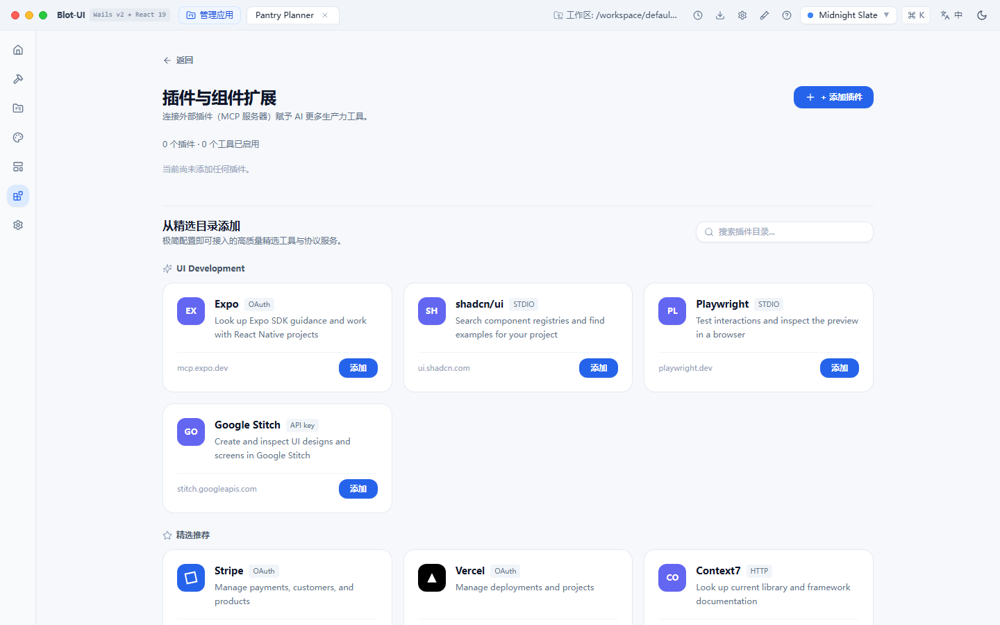

# BuildUI

> **コードがすべてを構築する。** BuildUI は、アイデア、参考デザイン、会話を動作するプロジェクトのプロトタイプへ変える、ローカルファーストのデスクトップワークスペースです。

[English](README.md) · [中文](README.zh-CN.md) · [Español](README.es.md) · [Português](README.pt-BR.md) · [Français](README.fr.md) · [日本語](README.ja.md)

## インストール

### macOS — Homebrew（推奨）

BuildUI は Homebrew Cask として配布されています。ターミナルからインストールまたは更新できます。

```bash
brew update
brew install --cask blue-idea/tap/buildui
```

既存のインストールを更新する場合：

```bash
brew update
brew upgrade --cask buildui
```

アンインストール：

```bash
brew uninstall --cask buildui
```

Homebrew がまだない場合は、[Homebrew 公式インストールガイド](https://brew.sh/) に従ってから上記のコマンドを実行してください。

### macOS — リリースをダウンロード

最新の [`BuildUI.dmg`](https://github.com/blue-idea/BuildUI/releases) をダウンロードし、`BuildUI.app` を `/Applications` にドラッグして起動します。macOS が隔離属性によって初回起動をブロックする場合は、次を実行してください。

```bash
xattr -dr com.apple.quarantine /Applications/BuildUI.app
```

リポジトリのインストーラーも利用できます。

```bash
/bin/bash -c "$(curl -fsSL https://raw.githubusercontent.com/blue-idea/BuildUI/main/scripts/install-mac.sh)"
```

### その他のプラットフォームとソースビルド

利用可能なプラットフォーム向けリリースを使うか、[ソースからビルド](#ソースからビルド)の手順に従ってください。

## BuildUI の目的

BuildUI はソフトウェア作成の中でも、視覚的なフィードバックが重要な段階に向けて設計されています。アイデアを説明し、プロダクトの方向性を決め、動作するプロトタイプを生成し、コードとライブプレビューで改善できます。Google Stitch、Bolt.new、v0 と同じ高速プロトタイピングの領域にありながら、プロジェクトと開発フローをローカルに保ちます。

BuildUI は **Claude Code、Cursor、その他のコーディングエージェントの代替ではありません**。ローカルプロジェクト、ライブプレビュー、視覚的な意図から編集可能なコードまでの短い経路を提供する、補完的なプロトタイピングレイヤーです。

## スクリーンショット


*Web、Desktop、App のプロトタイプを一つのワークスペースから開始できます。*



*コンポーネントセンターから再利用可能なツールとコンポーネントリソースを接続できます。*

## 主な機能

| 機能 | 内容 |
| --- | --- |
| **ローカルファースト** | プロジェクトファイル、SQLite データ、会話履歴、プレビュー、バージョンスナップショットをローカルワークスペースに保持します。リモート通信は設定したプロバイダーだけに送られます。 |
| **ローカライズ** | 英語と簡体字中国語の UI、およびモデル応答の言語指示に対応します。ドキュメントは英語、中文、スペイン語、ポルトガル語、フランス語、日本語で利用できます。 |
| **カスタムモデルとプロバイダー** | OpenAI、DeepSeek、ローカル Ollama に加え、OpenAI-compatible エンドポイントを利用でき、Base URL、API key、モデル名を設定できます。 |
| **コード生成前のブループリント** | 機能、レイアウト、ビジュアル方向を整理し、ブループリントを承認してから実装を開始します。 |
| **ローカルサンドボックスと分離検証** | 生成したプロジェクトをローカルプレビューで実行し、一時的な detached Git Worktree で本番ビルドを検証します。 |
| **自動コード修復** | TypeScript 診断とビルドチェックを実行し、問題を修復ループへ戻してから結果を再検証します。 |
| **部分的な再描画とローカル編集** | ライブプレビューで要素を選び、コンポーネントとソース領域を特定し、ボックスモデルを確認して対象だけを変更できます。 |
| **複数ターンの会話** | 追加指示、確認回答、添付ファイル、後続の修正を通じてプロジェクトのコンテキストを維持します。 |
| **スタイルの抽出と定義** | ブランド名、参考デザイン、スクリーンショットから配色、タイポグラフィ、角丸、タグ、再利用可能なスタイルプロンプトを抽出できます。 |
| **コンポーネント中心の設計** | スターターテンプレートと再利用可能な UI プリミティブから始め、プレビューの背後にあるソースコンポーネントを確認できます。 |
| **ライブプレビューとスナップショット** | Web、Desktop、App のプレビュー、カバー画像、コード確認、ZIP エクスポート、過去バージョンの確認に対応します。 |

## ワークフロー

1. **プロダクトを説明する。** Web、Desktop、App を選び、自然言語でプロトタイプを説明します。
2. **意図を整理する。** 機能、レイアウト、色、雰囲気について任意の質問に答えます。
3. **ブループリントを承認する。** 実装前に生成されたデザイン方針を確認します。
4. **ローカルサンドボックスで構築する。** BuildUI がプロジェクトを書き込み、不足する依存関係を追加し、プレビューを起動してコードを検証します。
5. **会話で改善する。** ページ、インタラクション、ビジュアル方針、選択したコンポーネントを変更します。
6. **スタイルを抽出して再利用する。** デザイン言語をプリセットとして保存し、次のプロトタイプに適用します。
7. **確認してエクスポートする。** プレビューとソースを確認し、カバーを保存、スナップショットへ戻す、またはプロジェクトをエクスポートします。

## モデル設定

**Settings → Models** からプロバイダーを設定します。

- **OpenAI** と **DeepSeek**：ホスト型モデル。
- **Ollama (Local)**：API key 不要のローカルモデルエンドポイント。
- **Custom (OpenAI-compatible)**：自前のゲートウェイや互換プロキシ。
- プロバイダーごとの **Base URL**、**API key**、**model name**。保存前に接続テストもできます。

BuildUI はモデルキーを同梱していません。自分の認証情報を使用し、選択したホスト型プロバイダーのプライバシーポリシーを確認してください。

## ソースからビルド

必要な環境：Go `1.26+`、Node.js `20+`、pnpm `9+`、Wails CLI `2.13+`、Git `2.30+`。

```bash
go install github.com/wailsapp/wails/v2/cmd/wails@v2.13.0
wails doctor
git clone https://github.com/blue-idea/BuildUI.git
cd BuildUI/frontend
pnpm install
cd ..
wails dev
```

プロダクションパッケージを作成する場合：

```bash
wails build
```

## 品質チェック

```bash
go test -v -race -cover ./...
pnpm test:readme
pnpm test:scripts
pnpm --prefix frontend test
pnpm --prefix frontend run lint
pnpm --prefix frontend exec tsc -p tsconfig.json --noEmit
pnpm --prefix frontend run build
```

UI を変更した場合は Playwright のフローでも確認し、スクリーンショットを証跡として保存してください。

## ドキュメントの言語

デフォルトは英語です。各 README の上部にあるリンクから切り替えられます。

- [English](README.md)
- [中文](README.zh-CN.md)
- [Español](README.es.md)
- [Português](README.pt-BR.md)
- [Français](README.fr.md)
- [日本語](README.ja.md)

## ライセンス

現在のライセンスとコントリビューション条件はリポジトリを確認してください。
