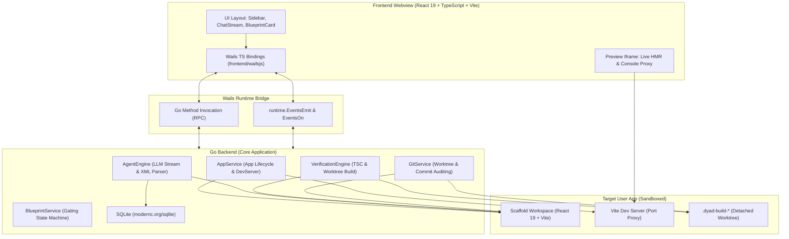

# BuildUI (Blot-UI)

> 基于 **Wails v2 + React 19 + Go** 构建的开源、本地优先、端到端闭环的 AI 原生应用构建桌面软件（AI App Builder）。

---

## 1. 项目简介

**BuildUI**（代号 **Blot-UI**）旨在打造真正可交付、功能闭环且零占位符的 Web 应用程序自动化构建桌面平台。系统深度融合了 **Go** 的高效并发与严谨系统级能力，以及 **React 19** 的现代化 UI 渲染能力，为开发者提供高可控、高响应、数据完全本地化的 AI 辅助应用研发体验。

### 核心特性

- **本地优先（Local-First）**：完全运行于本地桌面环境，应用元数据与会话状态持久化于嵌入式 SQLite，支持用户自带大模型密钥（BYOK），数据与代码资产 100% 归属本地。
- **工业级脚手架底座（Scaffold Foundation）**：预置成熟的 `React 19 + TypeScript + Vite + Tailwind CSS` 模板，内置 40+ shadcn/ui 全量交互组件，拒绝从零生成导致的版本冲突与配置缺失。
- **蓝图设计与前置门禁（App Blueprint Gate）**：通过交互式澄清问卷（`planning_questionnaire`）与方案蓝图审批机制，确保大模型在取得用户确认前不污染业务代码。
- **多 Agent 协同与职责隔离（Multi-Agent System）**：
  - **Orchestrator**：任务拆解与全局状态调度（`update_todos`）。
  - **Explorer**：只读探索代码符号与依赖关系，防范上下文膨胀。
  - **Implementer**：遵循严苛规范（`GOAL` / `MUST HOLD` / `OUT OF SCOPE` / `DONE WHEN`）执行精准编码。
- **多级闭环自愈验证流水线（Self-Healing Verification）**：
  - **第一道防线**：基于本地 `tsc` 静态类型检查，报错自动提取堆栈并回传模型自愈。
  - **第二道防线**：在独立的 **Git Worktree** 隔离区执行生产打包（`pnpm run build`），保障主工作区整洁。
- **本地宿主运行时与实时热重载（Live HMR & Process Supervision）**：Go 后端利用 `os/exec` 精准监管用户应用 Vite 开发服务器，通过流式 XML 解析增量落盘，实现毫秒级预览刷新与无孤儿进程退出。
- **版本时间旅行（Turn-based Git Snapshots）**：每个可写会话自动触发干净的 Git 提交，提供完整的历史追溯与版本回退能力。

---

## 2. 架构概览



---

## 3. 技术选型矩阵

| 领域 | 选型 | 版本要求 | 说明 |
| :--- | :--- | :--- | :--- |
| **桌面运行时** | Wails v2 | `^2.9.0` (推荐 `v2.13.0+`) | 轻量跨平台桌面框架，原生绑定 Go 后端与 Webview 前端 |
| **后端语言** | Go | `>= 1.24` (推荐 `go1.26+`) | 后端主服务、并发 Agent 调度与进程生命周期管理 |
| **本地数据库** | SQLite (`modernc.org/sqlite`) | 最新稳定版 | 纯 Go 嵌入式驱动，零 CGO 依赖，完美支持跨平台编译 |
| **版本管理驱动** | Git CLI / `go-git` | `v5+` | 管理提交审计、快照与 Worktree 隔离构建沙箱 |
| **前端框架** | React | `^19.0.0` | 桌面应用交互层与组件渲染 |
| **前端构建工具** | Vite | `^6.0.0` | 前端极速打包与 HMR 开发服务器 |
| **前端语言** | TypeScript | `^5.5.0` | 严格静态类型支持（强制 `strict: true`） |
| **通信机制** | Wails TS Bindings | 自动生成 | 强类型 RPC 方法绑定与事件总线 (`EventsEmit` / `EventsOn`) |
| **状态管理** | TanStack Query + Jotai | 最新稳定版 | 远程状态缓存与轻量原子化客户端状态 |
| **UI 原语库** | Base UI (`@base-ui/react`) | 最新稳定版 | 无障碍无样式 Headless 组件原语（杜绝 Radix UI 冗余） |
| **样式系统** | Tailwind CSS | `^3.4.0` / `^4.0.0` | 实用优先的高性能 CSS 引擎 |
| **富文本与输入** | Lexical | 最新稳定版 | 支持 Mention 与语法高亮的 AI 输入框 |

---

## 4. 环境要求与先决条件

在开始之前，请确保本地已安装以下环境依赖：

1. **Go**：`>= 1.24`（推荐 `1.26+`）  
   验证命令：`go version`
2. **Node.js & pnpm**：Node.js `>= 20.0.0`，pnpm `>= 9.0.0`（禁止与 npm / yarn 混用）  
   验证命令：`node -v` 以及 `pnpm -v`
3. **Wails v2 CLI**：  
   安装命令：`go install github.com/wailsapp/wails/v2/cmd/wails@latest`  
   环境诊断：`wails doctor`
4. **Git**：`>= 2.30.0`（用于项目管理及 Worktree 隔离构建）

---

## 5. 快速上手

### 5.1 克隆仓库与依赖准备

```bash
# 克隆仓库
git clone https://github.com/your-org/BuildUI.git
cd BuildUI

# 进入前端目录并安装依赖
cd frontend
pnpm install
cd ..
```

### 5.2 启动本地开发服务

Wails 提供内置的实时热重载（HMR）环境：

```bash
# 根目录下执行
wails dev
```

该命令将同时启动 Go 后端编译与前端 Vite 调试服务器，并打开桌面应用调试窗口。

### 5.3 生产构建与打包

```bash
# 编译生成生产模式二进制桌面安装包
wails build
```

打包生成的可执行文件将位于 `build/bin/` 目录中。

---

## 6. 测试与质量规范（QA & TDD）

项目严格推行**测试驱动开发（TDD）**与自动化质量防线，严禁在未真实执行的情况下断言测试通过。

### 6.1 单元与集成测试

- **Go 后端测试**：
  ```bash
  # 执行全量单元测试与竞态检测
  go test -v -race -cover ./...
  ```
- **前端组件与逻辑测试**：
  ```bash
  cd frontend
  pnpm test
  ```

### 6.2 桌面端 E2E 与视觉回归测试

- 桌面端端到端业务流与视觉回归基于 **Playwright** 驱动。
- **强制约束**：
  1. 涉及 UI 变更与桌面端 E2E 验证的任务，**必须截图留证**保存在测试报告目录中。
  2. 视觉回归必须生成 Baseline 基线与 Diff 差异对比图。

---

## 7. 目录结构规范

```text
BuildUI/
├── .agents/                    # 智能体技能与协作配置
├── docs/                       # 系统规格、架构文档与知识库
│   ├── architecture-overview.md# Dyad 核心架构深度解构
│   ├── knowledge/              # 规则、提示词与参考实现
│   └── spec/                   # SDD 规范体系 (v1/constitution/requirements/design/tasks)
├── build/                      # Wails 资源、图标与打包配置
│   └── bin/                    # 生产打包产物输出（已被 .gitignore 忽略）
├── frontend/                   # 前端 Webview 源码 (React 19 + TypeScript + Vite)
│   ├── src/                    # 页面组件、状态模型与 UI 原语
│   ├── wailsjs/                # Wails 自动生成的 Go 类型与 RPC 绑定代码
│   └── package.json            # 前端依赖配置
├── internal/                   # Go 后端核心业务实现
│   ├── app/                    # 应用管理服务（脚手架展开、进程监听）
│   ├── blueprint/              # 蓝图设计与问卷门禁状态机
│   ├── agent/                  # LLM 流式交互与 XML 增量写入引擎
│   ├── db/                     # SQLite 数据驱动与自动化迁移
│   ├── git/                    # Git Worktree 沙箱与快照管理
│   ├── verification/           # TSC 检查与构建验证引擎
│   └── errs/                   # BlotError 强类型错误定义
├── scaffold/                   # 目标应用工业级脚手架模板 (React 19 + shadcn/ui)
├── AGENTS.md                   # 智能体工程化协作与沟通规范
├── .gitattributes              # 跨平台 LF 换行符强制规范
├── .gitignore                  # Git 忽略配置
└── README.md                   # 项目介绍文档
```

---

## 8. 规范与文档导航

- [Dyad 架构深度解构](docs/architecture-overview.md)
- [项目技术栈规范 (Tech Stack)](docs/spec/steering/tech-stack.md)
- [项目宪法与架构红线 (Constitution)](docs/spec/versions/v1/constitution.md)
- [需求规格说明书 (Requirements)](docs/spec/versions/v1/requirements.md)
- [系统设计说明书 (Design)](docs/spec/versions/v1/design.md)
- [实施任务清单 (Tasks)](docs/spec/versions/v1/tasks.md)
- [测试策略与验收标准 (Test Strategy)](docs/spec/test_strategy.md)
- [协作与工程化规范](AGENTS.md)

---

## 9. 许可证与致谢

- 核心架构启发并致敬开源项目 [Dyad](https://github.com/dyad-sh/dyad)。
- 本项目遵循开源协议发布。
