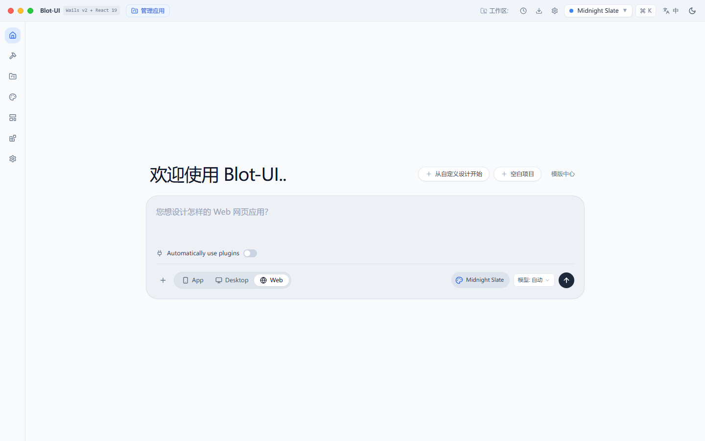

# BuildUI

> **代码构建一切。** BuildUI 是一个本地优先的桌面工作区，用于把想法、参考设计和多轮对话快速变成可运行的项目原型。

[English](README.md) · [中文](README.zh-CN.md) · [Español](README.es.md) · [Português](README.pt-BR.md) · [Français](README.fr.md) · [日本語](README.ja.md)

## 安装

### macOS — 使用 Homebrew（推荐）

BuildUI 以 Homebrew Cask 形式发布。打开终端执行：

```bash
brew update
brew install --cask blue-idea/tap/buildui
```

更新已有安装：

```bash
brew update
brew upgrade --cask buildui
```

卸载：

```bash
brew uninstall --cask buildui
```

如果尚未安装 Homebrew，请先按照 [Homebrew 官方安装指南](https://brew.sh/) 操作，再执行上面的命令。Homebrew 会将 `BuildUI.app` 安装到应用程序目录，之后即可正常启动。

### macOS — 下载发行版

从 [GitHub Releases](https://github.com/blue-idea/BuildUI/releases) 下载最新的 [`BuildUI.dmg`](https://github.com/blue-idea/BuildUI/releases)，将 `BuildUI.app` 拖入 `/Applications`。如果 macOS 因下载隔离属性阻止首次启动，可执行：

```bash
xattr -dr com.apple.quarantine /Applications/BuildUI.app
```

也可以使用仓库提供的一键脚本，它会下载最新版本并安装到 `/Applications`：

```bash
/bin/bash -c "$(curl -fsSL https://raw.githubusercontent.com/blue-idea/BuildUI/main/scripts/install-mac.sh)"
```

### 其他平台与源码构建

如果对应平台已有发行包，请使用发行包；否则可以按照[从源码构建](#从源码构建)进行本地编译。

## 为什么是 BuildUI

BuildUI 面向软件创建中最需要快速反馈的阶段：描述想法、确定产品方向、生成可运行原型，再通过代码和实时预览持续迭代。它与 Google Stitch、Bolt.new、v0 处在相同的快速原型方向，但项目工作区和开发流程优先保留在本地。

BuildUI **不是 Claude Code、Cursor 或其他编码 Agent 的替代品**。它更像一个互补的原型构建层，适合需要本地项目、实时预览，以及从视觉意图快速落到可编辑代码的个人和团队。

## 软件截图



*在一个聚焦的工作区中开始 Web、Desktop 或 App 原型。*


*通过组件中心连接可复用工具和组件资源。*

## 核心能力

| 能力 | 说明 |
| --- | --- |
| **本地优先工作流** | 项目文件、SQLite 应用数据、对话历史、预览和版本快照都保存在本地桌面工作区。只有配置的模型服务商会接收远程模型请求。 |
| **本地化** | 提供英文与简体中文界面及模型回复约束；README 文档提供英文、中文、西班牙语、葡萄牙语、法语和日语版本。 |
| **自定义模型与服务商** | 内置 OpenAI、DeepSeek、本地 Ollama，也支持任意 OpenAI-compatible 接口，并可分别配置 Base URL、API Key 和模型名称。 |
| **先蓝图、后代码** | 先澄清功能、布局和视觉方向，生成设计蓝图并等待用户批准，再开始实现代码。 |
| **本地沙箱与隔离校验** | 在本地预览环境中运行生成的项目，并在临时 detached Git Worktree 中执行生产构建验证，避免验证过程污染主工作区。 |
| **自动代码修复** | 执行 TypeScript 诊断与构建检查，把可操作的问题反馈给修复循环，在构建完成前再次验证结果。 |
| **局部重绘与局部编辑** | 在实时预览中点选元素，定位组件路径和源码区域，查看盒模型，并提交只针对该区域的修改，不必重写整页。 |
| **多轮对话修改** | 通过增量指令、澄清回答、附件和后续修改持续推进项目，同时保留实时预览与变更文件上下文。 |
| **风格提取与定义** | 输入品牌名、设计参考或上传截图，提取配色、字体、圆角、标签和可复用风格提示词，并保存为 Web、App 或 Desktop 风格预设。 |
| **组件化项目** | 从起步模板和可复用 UI 原语开始，点选预览元素即可查看背后的源码组件，并通过组件中心接入工具与组件资源。 |
| **实时预览与项目快照** | 支持 Web、Desktop、App 预览，截取项目封面，查看源代码，导出独立 ZIP，并回看版本快照。 |

## 使用流程

1. **描述产品。** 选择 Web、Desktop 或 App，用自然语言描述原型。
2. **澄清意图。** 可选回答功能、布局、颜色和氛围问题。
3. **批准蓝图。** 在开始实现前审阅生成的设计方向。
4. **在本地沙箱构建。** BuildUI 写入项目、按需安装缺失依赖、启动预览并验证代码。
5. **通过对话迭代。** 添加页面、修改交互、替换视觉方向，或只改某个点选组件。
6. **提取并复用风格。** 将设计语言保存为预设，应用到未来的原型。
7. **审查与导出。** 查看预览和源码，截取封面，回退快照或导出项目。

## 模型配置

进入 **设置 → 模型** 配置服务商：

- **OpenAI** 与 **DeepSeek**：连接托管模型。
- **Ollama (Local)**：连接本地模型，不需要 API Key。
- **Custom (OpenAI-compatible)**：连接自托管网关、兼容代理或其他服务商。
- 每个服务商都可以单独设置 **Base URL**、**API Key** 和 **Model Name**，保存前可以测试连接。

BuildUI 不内置模型密钥。请使用自己的凭据，并阅读所选托管服务商的隐私政策。

## 局部编辑与多轮修改

在实时预览中开启 **Local Edit**，然后点选元素。BuildUI 会将相关组件路径、行范围、源码片段和盒模型上下文附加到下一条指令。你可以查看代码、跳转源码视图、使用“调整配色/间距”等快捷操作，或输入自定义需求。修改会成为普通对话轮次，并通过同一套本地构建循环进行验证。

## 从源码构建

### 环境要求

- Go `1.26+`
- Node.js `20+`
- pnpm `9+`
- Wails CLI `2.13+`
- Git `2.30+`

安装 Wails CLI 并检查本机工具链：

```bash
go install github.com/wailsapp/wails/v2/cmd/wails@v2.13.0
wails doctor
```

克隆仓库并安装前端依赖：

```bash
git clone https://github.com/blue-idea/BuildUI.git
cd BuildUI/frontend
pnpm install
cd ..
```

启动带实时重载的桌面开发应用：

```bash
wails dev
```

构建生产包：

```bash
wails build
```

## 质量检查

根据修改范围执行对应检查：

```bash
# Go 后端测试
go test -v -race -cover ./...

# README 与发布脚本契约测试
pnpm test:readme
pnpm test:scripts

# 前端测试、Lint、类型检查与构建
pnpm --prefix frontend test
pnpm --prefix frontend run lint
pnpm --prefix frontend exec tsc -p tsconfig.json --noEmit
pnpm --prefix frontend run build
```

涉及 UI 的改动还应使用仓库 Playwright 流程，并保留截图证据。

## 文档语言

默认文档语言为英语。点击任意 README 顶部的语言链接即可切换：

- [English](README.md)
- [中文](README.zh-CN.md)
- [Español](README.es.md)
- [Português](README.pt-BR.md)
- [Français](README.fr.md)
- [日本語](README.ja.md)

## 许可证

当前许可证和贡献条款请以仓库中的最新信息为准。
