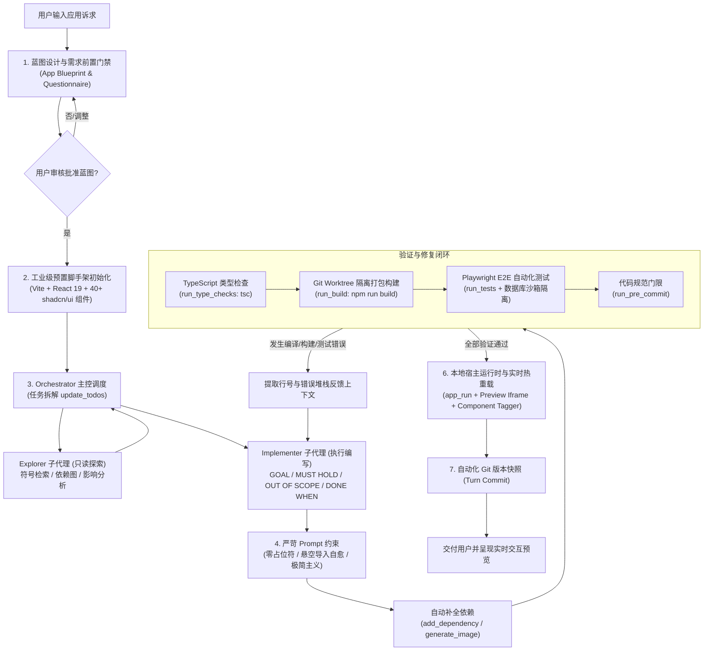

# Dyad 核心架构剖析：为什么能够生成非常完整的应用构建？

> 本文系统性解构 Dyad（开源本地 AI 应用构建器）如何实现高完成度、功能闭环且零占位符的 Web 应用程序自动化构建与迭代。  
> 官方源码仓库地址：[https://github.com/dyad-sh/dyad](https://github.com/dyad-sh/dyad)

---

## 1. 核心架构全景

---

## 2. 七大核心支柱详解

### 支柱一：工业级预置脚手架（Scaffold Foundation）
传统 AI 代码生成往往尝试从空白目录新建所有配置文件，极易导致 Vite、PostCSS、Tailwind、tsconfig 依赖版本冲突或配置缺失。Dyad 采用模板预置策略：
1. **开箱即用的现代化技术底座**：
   - 基础架构基于 `Vite + React 19 + TypeScript + Tailwind CSS + React Router + TanStack Query`（详见源码 [scaffold/package.json](https://github.com/dyad-sh/dyad/blob/main/scaffold/package.json)）。
   - 预设好了全局状态、路由分发与 404 兜底机制（源码：[scaffold/src/App.tsx](https://github.com/dyad-sh/dyad/blob/main/scaffold/src/App.tsx)）。
2. **全量预装 40+ shadcn/ui 组件**：
   - 脚手架目录 [scaffold/src/components/ui/](https://github.com/dyad-sh/dyad/tree/main/scaffold/src/components/ui) 中完整内置了 Accordion、Alert-Dialog、Button、Card、Carousel、Chart、Command、Dialog、Dropdown、Form、Input、Popover、Sheet、Sidebar、Table、Tabs、Toast、Tooltip 等全部基础与高级交互组件。
   - 所有 Radix UI 原语和 Lucide 图标库均已安装并测试兼容。
3. **内置代码规范引导（[scaffold/AI_RULES.md](https://github.com/dyad-sh/dyad/blob/main/scaffold/AI_RULES.md)）**：
   - 强约束应用代码必须写入 `src/`，页面放入 `src/pages/`，组件放入 `src/components/`，默认路由始终绑定至 `src/pages/Index.tsx`（源码：[scaffold/src/pages/Index.tsx](https://github.com/dyad-sh/dyad/blob/main/scaffold/src/pages/Index.tsx)）。
   - 脚手架拷贝服务实现见 [src/ipc/handlers/createFromTemplate.ts](https://github.com/dyad-sh/dyad/blob/main/src/ipc/handlers/createFromTemplate.ts)。
   - 严禁重写已有 UI 组件，避免代码膨胀和版本回退。

### 支柱二：蓝图设计与需求前置收敛（App Blueprint Gate）
为解决用户需求模糊导致的代码结构失真，Dyad 在进入实际写代码前设置了严格的阶段性门禁：
1. **结构化需求问卷（`planning_questionnaire`）**：
   - 在接收到新应用需求时，主控 Agent 必须调用问卷工具提出 1~5 个关键产品问题（设计风格、目标客群、是否需要用户体系、是否需要持久化数据库）。
2. **标准蓝图数据生成（[write_app_blueprint.ts](https://github.com/dyad-sh/dyad/blob/main/src/pro/main/ipc/handlers/local_agent/tools/write_app_blueprint.ts)）**：
   - 确定应用名称、设计方向（Design Direction）、品牌主色调（Primary Color）及应用所必需的视觉资产（Logo、插图、背景、图标 prompts）。蓝图数据契约定义见 [src/ipc/types/app_blueprint.ts](https://github.com/dyad-sh/dyad/blob/main/src/ipc/types/app_blueprint.ts)。
3. **用户审批控制流（[app_blueprint_handlers.ts](https://github.com/dyad-sh/dyad/blob/main/src/ipc/handlers/app_blueprint_handlers.ts)）**：
   - 生成蓝图后 Agent 的 Turn 会自动中断，等待用户在 UI 界面点击“Approve Blueprint”。
   - 只有蓝图被批准后，Agent 才会正式拉取脚手架并开始执行具体编码。

### 支柱三：多 Agent 分工协同与角色特化（Multi-Agent System）
Dyad 设计了专门的子代理协同机制（源码见 [src/pro/main/ipc/handlers/local_agent/tools/subagent_tools.ts](https://github.com/dyad-sh/dyad/blob/main/src/pro/main/ipc/handlers/local_agent/tools/subagent_tools.ts)），避免单一 Agent 上下文过载：
- **Orchestrator（主协调器）**：把控全局方向，维护 `update_todos` 任务清单，负责设计方案与审查最终 Diff。
- **Explorer Subagent（`persona="explorer"`）**：
  - 只读探索子代理，负责深入代码库、分析目录结构、搜索相关函数与符号。
  - 将探索所得整理成精准的结构报告回传给主控，不污染主 Agent 的推理空间。
- **Implementer Subagent（`persona="implementer"`）**：
  - 严格通过标准化规范工单接收任务：
    - `GOAL`：清晰的一两句话目标定义。
    - `MUST HOLD`：必须满足的项目不变量（数据作用域、鉴权边界、组件规范）。
    - `OUT OF SCOPE`：防溢出范围边界。
    - `DONE WHEN`：必须通过的检查项与自测标准。
  - Implementer 自带代码自检能力，完成后生成变更报告。

### 支柱四：严苛的 Prompt 工程与防偷懒策略
在提示词引擎 [src/prompts/local_agent_prompt.ts](https://github.com/dyad-sh/dyad/blob/main/src/prompts/local_agent_prompt.ts) 与 [src/prompts/system_prompt.ts](https://github.com/dyad-sh/dyad/blob/main/src/prompts/system_prompt.ts) 中植入了严密的防幻觉与防偷懒指令：
1. **零占位符规则**：
   - 严禁生成 `// TODO`、`/* Implement later */` 或省略号代码。
   - 严禁告知用户“自行补充组件实现”。
   - 要求每一个生成的组件必须全功能可用（Fully Functional）。
2. **导入完整性闭环检查**：
   - **内部模块**：只要引入了内部文件，若该文件尚不存在，必须在同一个响应中通过 [write_file.ts](https://github.com/dyad-sh/dyad/blob/main/src/pro/main/ipc/handlers/local_agent/tools/write_file.ts) 创建。
   - **第三方包**：只要引用了未在 `package.json` 中的 npm 包，必须通过 [add_dependency.ts](https://github.com/dyad-sh/dyad/blob/main/src/pro/main/ipc/handlers/local_agent/tools/add_dependency.ts) 显式安装，彻底避免 runtime 报 `Module not found`。
3. **极简主义规范**：
   - 禁止过度工程化，禁止添加无用的向下兼容代码或未被要求的虚构配置。

### 支柱五：多级闭环验证与自动修复流水线（Closed-Loop Verification）
代码写入磁盘并不是结束，而是自检的开始：
1. **静态类型检查（[run_type_checks.ts](https://github.com/dyad-sh/dyad/blob/main/src/pro/main/ipc/handlers/local_agent/tools/run_type_checks.ts)）**：
   - 直接调用原生 `tsc` 对工作区执行全量或增量检查。
   - 如果发生编译报错，精确捕获文件路径、行号与错误信息，反馈给模型即时自动修复（底层实现：[src/ipc/handlers/problems_handlers.ts](https://github.com/dyad-sh/dyad/blob/main/src/ipc/handlers/problems_handlers.ts)）。
2. **隔离环境真实打包构建（[run_build.ts](https://github.com/dyad-sh/dyad/blob/main/src/pro/main/ipc/handlers/local_agent/tools/run_build.ts)）**：
   - 为了确保应用不仅在开发模式能跑，更具备生产可用性，Dyad 会通过 [src/ipc/services/git_overlay_workspace.ts](https://github.com/dyad-sh/dyad/blob/main/src/ipc/services/git_overlay_workspace.ts) 创建独立的 **Git Overlay Worktree** 隔离快照。
   - 在干净的沙箱环境中执行真实的 `npm run build`，捕获任何打包器（Vite/Rollup）配置错误、静态导出问题与 CSS 构建失败。
3. **自动化端到端测试（[run_tests.ts](https://github.com/dyad-sh/dyad/blob/main/src/pro/main/ipc/handlers/local_agent/tools/run_tests.ts)）**：
   - 支持 Playwright E2E 测试，具备测试数据库隔离（Supabase/Neon 测试环境沙箱，见 [src/ipc/handlers/tests_handlers.ts](https://github.com/dyad-sh/dyad/blob/main/src/ipc/handlers/tests_handlers.ts)）。
   - 记录测试失败签名，截取失败瞬间截图，精准定位交互缺陷。
4. **提交前钩子（`run_pre_commit`）**：
   - 自动化格式化与静态检查，确保代码库干净统一。

### 支柱六：本地宿主运行时与即时反馈系统（Local Runtime & Live Preview）
1. **本地开发服务器监管**：
   - Dyad 作为 Electron 桌面程序，主进程拥有完整的进程监管能力（状态机见 [src/app_run/definition.ts](https://github.com/dyad-sh/dyad/blob/main/src/app_run/definition.ts)）。
   - 自动分配端口、运行开发服务器并注入代理。
2. **双向交互预览 Iframe**：
   - 客户端右侧内嵌实时预览 Iframe（控制器见 [src/preview_iframe/controller.ts](https://github.com/dyad-sh/dyad/blob/main/src/preview_iframe/controller.ts)），支持 Vite HMR 热更新。
   - 预装 `@dyad-sh/react-vite-component-tagger`，支持用户点击界面元素反查源码组件位置。
   - 运行时控制台（[src/preview_console/store.ts](https://github.com/dyad-sh/dyad/blob/main/src/preview_console/store.ts)）实时捕获前端运行时报错，并在必要时反馈给 Agent 进行自愈。

### 支柱七：全栈后端集成与真实视觉媒体
1. **原生支持 Supabase 与 Neon Postgres**：
   - 提供 [execute_sql.ts](https://github.com/dyad-sh/dyad/blob/main/src/pro/main/ipc/handlers/local_agent/tools/execute_sql.ts) 数据库执行工具、自动化 RLS 安全策略建议。
   - 数据库 Schema 与元数据持久化见 [src/db/schema.ts](https://github.com/dyad-sh/dyad/blob/main/src/db/schema.ts)。
2. **AI 原生多媒体资产生成（`generate_image`）**：
   - 当应用需要 Logo、Banner、插画或头像时，Agent 调用内置图像生成工具直接输出保存在项目目录的实体图片文件，杜绝随机网络链接失效引发的 broken image。
3. **Turn-Level 自动 Git 提交**：
   - 每个可写会话周期结束时自动打出规范的 Git Commit（核心服务见 [src/ipc/services/git_service.ts](https://github.com/dyad-sh/dyad/blob/main/src/ipc/services/git_service.ts) 与 [src/ipc/handlers/chat_stream_handlers.ts](https://github.com/dyad-sh/dyad/blob/main/src/ipc/handlers/chat_stream_handlers.ts)），为用户应用提供天然的撤销/重做与时间旅行能力。

---

## 3. 关键机制对比

| 维度 | 普通 AI 代码生成器 / 聊天助手 | Dyad 应用构建引擎 |
| :--- | :--- | :--- |
| **启动基线** | 从零生成配置或依赖网络模板 | 本地预置成熟 Vite + React 19 + 40+ shadcn 全组件 |
| **需求收敛** | 依靠单次 prompt 猜测 | 强制执行 Clarification 问卷与 App Blueprint 审批门禁 |
| **完整性保障** | 常见 `// TODO`、缺导入、缺依赖 | 提示词强制 Fully Functional + 悬空导入自愈机制 |
| **质量自检** | 仅输出文本，无法感知报错 | 内置 `tsc`、Git 隔离 Worktree `npm run build`、E2E 测试闭环自愈 |
| **运行时环境** | 纯远程容器或 WebContainer 受限沙箱 | 本地原生全权 Node.js 运行时 + 自动化进程监管 |
| **版本安全** | 无版本或简单的撤销 | 自动绑定本地原生 Git 提交历史，支持版本对比与分支回滚 |
