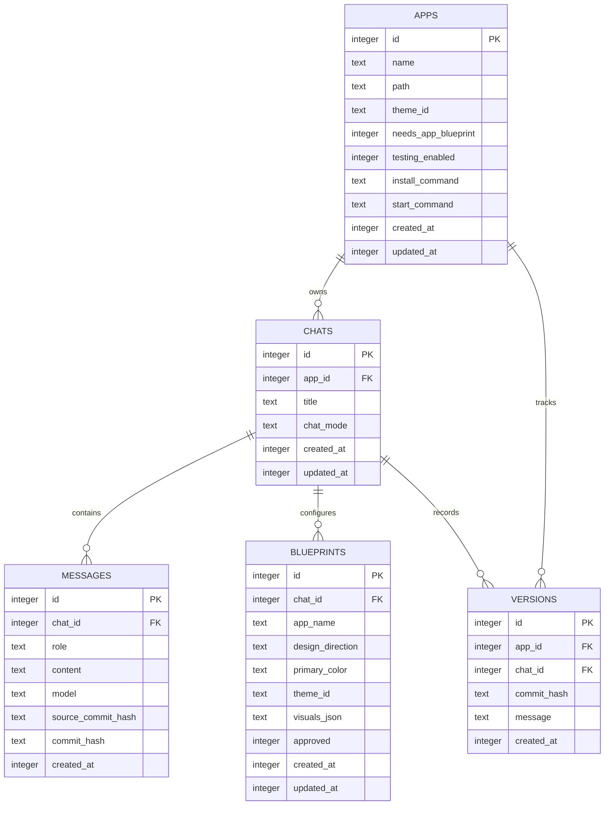

# 数据与存储设计说明书（Data）· Blot-UI (Wails + React)

> 文件路径：`docs/spec/versions/v1/data.md`  
> 规范版本：v1 · 日期：2026-11-20  
> 关联设计：[design.md](design.md)  
> 核心驱动：Go 纯内存/文件 SQLite (`modernc.org/sqlite`)  
> 官方源码参考：[https://github.com/dyad-sh/dyad](https://github.com/dyad-sh/dyad)

---

## 1. 存储架构全景

Blot-UI 的数据存储采用典型的本地优先双轨体系：
1. **结构化元数据存储**：使用嵌入式 SQLite 数据库，选用纯 Go 驱动 `modernc.org/sqlite`。该驱动完全由 Go 编译，无需 Windows GCC 编译环境，无 CGO 依赖，支持事务与严格的 Foreign Key 完整性约束。
2. **应用工作区与版本资产**：直接由操作系统文件系统承载，各应用建立独立的 Git 仓库，生产构建在独立的临时 Git Worktree 沙箱中运行。

---

## 2. 数据库实体关系模型 (ERD)



---

## 3. SQL DDL Schema 定义

```sql
-- 1. 应用表
CREATE TABLE IF NOT EXISTS apps (
    id INTEGER PRIMARY KEY AUTOINCREMENT,
    name TEXT NOT NULL,
    path TEXT NOT NULL UNIQUE,
    theme_id TEXT DEFAULT 'default',
    needs_app_blueprint INTEGER NOT NULL DEFAULT 1,
    testing_enabled INTEGER NOT NULL DEFAULT 0,
    install_command TEXT,
    start_command TEXT,
    created_at INTEGER NOT NULL DEFAULT (strftime('%s', 'now')),
    updated_at INTEGER NOT NULL DEFAULT (strftime('%s', 'now'))
);

-- 2. 对话表
CREATE TABLE IF NOT EXISTS chats (
    id INTEGER PRIMARY KEY AUTOINCREMENT,
    app_id INTEGER NOT NULL REFERENCES apps(id) ON DELETE CASCADE,
    title TEXT NOT NULL,
    chat_mode TEXT NOT NULL DEFAULT 'agent',
    created_at INTEGER NOT NULL DEFAULT (strftime('%s', 'now')),
    updated_at INTEGER NOT NULL DEFAULT (strftime('%s', 'now'))
);

-- 3. 消息表
CREATE TABLE IF NOT EXISTS messages (
    id INTEGER PRIMARY KEY AUTOINCREMENT,
    chat_id INTEGER NOT NULL REFERENCES chats(id) ON DELETE CASCADE,
    role TEXT NOT NULL,
    content TEXT NOT NULL,
    model TEXT,
    source_commit_hash TEXT,
    commit_hash TEXT,
    created_at INTEGER NOT NULL DEFAULT (strftime('%s', 'now'))
);

-- 4. 应用蓝图表
CREATE TABLE IF NOT EXISTS blueprints (
    id INTEGER PRIMARY KEY AUTOINCREMENT,
    chat_id INTEGER NOT NULL UNIQUE REFERENCES chats(id) ON DELETE CASCADE,
    app_name TEXT NOT NULL,
    design_direction TEXT NOT NULL,
    primary_color TEXT NOT NULL,
    theme_id TEXT NOT NULL DEFAULT 'default',
    visuals_json TEXT NOT NULL DEFAULT '[]',
    approved INTEGER NOT NULL DEFAULT 0,
    created_at INTEGER NOT NULL DEFAULT (strftime('%s', 'now')),
    updated_at INTEGER NOT NULL DEFAULT (strftime('%s', 'now'))
);

-- 5. 版本快照审计表
CREATE TABLE IF NOT EXISTS versions (
    id INTEGER PRIMARY KEY AUTOINCREMENT,
    app_id INTEGER NOT NULL REFERENCES apps(id) ON DELETE CASCADE,
    chat_id INTEGER REFERENCES chats(id) ON DELETE SET NULL,
    commit_hash TEXT NOT NULL,
    message TEXT NOT NULL,
    created_at INTEGER NOT NULL DEFAULT (strftime('%s', 'now'))
);
```

---

## 4. Go 数据实体模型定义

```go
package db

import "time"

// AppEntity 应用数据模型
type AppEntity struct {
    ID                int64     `json:"id"`
    Name              string    `json:"name"`
    Path              string    `json:"path"`
    ThemeID           string    `json:"themeId"`
    NeedsAppBlueprint bool      `json:"needsAppBlueprint"`
    TestingEnabled    bool      `json:"testingEnabled"`
    InstallCommand    string    `json:"installCommand"`
    StartCommand      string    `json:"startCommand"`
    CreatedAt         time.Time `json:"createdAt"`
    UpdatedAt         time.Time `json:"updatedAt"`
}

// ChatEntity 会话数据模型
type ChatEntity struct {
    ID        int64     `json:"id"`
    AppID     int64     `json:"appId"`
    Title     string    `json:"title"`
    ChatMode  string    `json:"chatMode"`
    CreatedAt time.Time `json:"createdAt"`
    UpdatedAt time.Time `json:"updatedAt"`
}

// MessageEntity 消息数据模型
type MessageEntity struct {
    ID               int64     `json:"id"`
    ChatID           int64     `json:"chatId"`
    Role             string    `json:"role"`
    Content          string    `json:"content"`
    Model            string    `json:"model"`
    SourceCommitHash string    `json:"sourceCommitHash"`
    CommitHash       string    `json:"commitHash"`
    CreatedAt        time.Time `json:"createdAt"`
}

// BlueprintEntity 蓝图数据模型
type BlueprintEntity struct {
    ID              int64     `json:"id"`
    ChatID          int64     `json:"chatId"`
    AppName         string    `json:"appName"`
    DesignDirection string    `json:"designDirection"`
    PrimaryColor    string    `json:"primaryColor"`
    ThemeID         string    `json:"themeId"`
    VisualsJSON     string    `json:"visualsJson"`
    Approved        bool      `json:"approved"`
    CreatedAt       time.Time `json:"createdAt"`
    UpdatedAt       time.Time `json:"updatedAt"`
}
```
