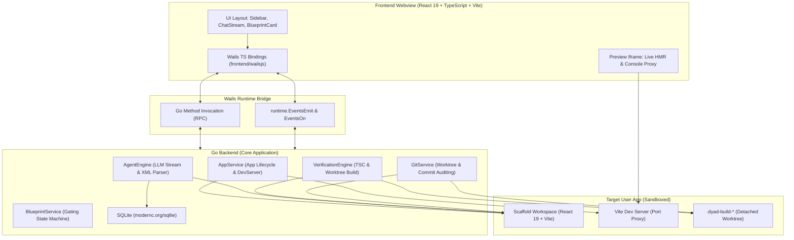
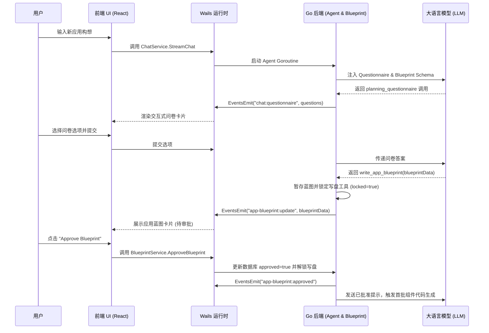

# 系统设计说明书（Design）· Blot-UI (Wails + React)

> 文件路径：`docs/spec/versions/v1/design.md`  
> 规范版本：v1 · 日期：2026-11-20  
> 关联需求：[requirements.md](requirements.md)  
> 数据库设计：[data.md](data.md)  
> 接口契约设计：[api.md](api.md)  
> 官方源码参考：[https://github.com/dyad-sh/dyad](https://github.com/dyad-sh/dyad)

---

## 1. 系统总体架构

Blot-UI 采用基于 **Wails v2** 的高性能轻量桌面双层架构：
- **前端展示层（Webview / React 19）**：负责 UI 交互、蓝图审批卡片展示、实时流式 Markdown 渲染、代码高亮、内嵌 Preview Iframe 以及控制台捕获。
- **后端服务层（Go 1.26 Backend）**：依托 Go 的高并发 Goroutine 与严谨的强类型生态，承担本地数据库管理、多代理流式会话调度、子进程生命周期监管、Git 快照隔离与自愈流水线。

---

## 2. 核心模块详细设计

### 2.1 蓝图设计与前置门禁模块（App Blueprint & Questionnaire）
- **职责**：确保 AI 在未得到用户明确设计认可前，严禁修改业务代码。
- **执行流**：
  1. 用户发起对话，Go 后端检测当前 Chat 是否已有批准的蓝图。
  2. 若未批准，大模型注入 `planning_questionnaire` 工具，向前端推送澄清问卷卡片。
  3. 用户提交问卷后，大模型输出 `write_app_blueprint` 生成蓝图元数据。
  4. Go 后端状态机将该会话挂起为 `waiting_approval`，彻底禁用 `write_file` 等破坏性工具。
  5. 用户在前端卡片点击“Approve”后，Go 后端持久化标记，并向会话流注入批准事件，解锁写盘工具。

### 2.2 脚手架展开与子进程监管模块（AppService）
- **Scaffold 展开**：
  - 维护官方经过预编译校验的 React 19 + Tailwind + shadcn/ui 组件脚手架目录。
  - 创建应用时，使用 Go 文件系统递归展开至目标路径，并使用 Git CLI 初始化提交。
- **开发服务器监管**：
  - Go 后端利用 `os/exec.CommandContext` 启动 `pnpm run dev`。
  - 监听控制台输出捕获本地端口（如 `http://127.0.0.1:5173`），回传给前端 Preview Iframe 渲染。
  - 当切换应用或关闭窗口时，Go Context 发出 `SIGTERM/SIGKILL` 信号，确保无孤儿进程残留。

### 2.3 流式 XML 解析与增量写入引擎（AgentEngine）
- **XML 状态机**：
  - LLM 以流式 Token 返回 `<dyad-write path="...">code</dyad-write>` 标记。
  - Go 后端采用基于 Channel 的增量流式 Token 解析器，实时匹配标签边界，边接收 Token 边写入本地磁盘。
  - 写入操作自动触发本地 Vite 开发服务器的 HMR，使右侧 Preview Iframe 瞬间呈现动态变化。

### 2.4 自愈闭环与 Worktree 隔离构建验证（VerificationEngine）
- **第一道防线 · TypeScript 编译检查**：
  - Agent 单轮写入结束后，Go 自动在目标目录执行 `pnpm exec tsc --noEmit`。
  - 若报错，将报错的文件路径、行号与编译器诊断文本打包作为 System Feedback 反馈给 LLM，触发自愈修复循环。
- **第二道防线 · 隔离 Git Worktree 生产打包**：
  - 重大功能完成或用户触发部署前，Go 调用 `git worktree add .dyad-build-xxxx` 创建隔离工作区。
  - 在隔离区执行 `pnpm run build`，彻底验证生产打包（Bundle & Rollup）完整性，构建完成后自动清理 Worktree。

---

## 3. 技术选型与决策理由

| 领域 | 选型 | 理由与收益 |
| :--- | :--- | :--- |
| **桌面运行时** | Wails v2 | 原生轻量（安装包仅 15~20MB，比 Electron 节省 80% 内存），Go 原生多线程能力极佳 |
| **后端主语言** | Go 1.26 | 强静态类型、极高并发执行效率、低延迟文件 I/O、极简的二进制分发 |
| **本地嵌入数据库** | SQLite (`modernc.org/sqlite`) | 纯 Go 原生实现，无 CGO 依赖，在 Windows 环境下免配置 GCC 即可顺畅编译和测试 |
| **前端主框架** | React 19 + TypeScript | 与目标生成应用的 React 生态统一，便于组件预览与反查器通信 |
| **前端通信绑定** | Wails 生成 TS Bindings | 消除手写 IPC 路由错误，前后端接口拥有完整的编译期静态类型提示 |
| **UI 基础原语** | Base UI (`@base-ui/react`) | 无样式、无障碍访问良好的现代 Headless 原语，杜绝 Radix UI 的依赖包体积问题 |
| **样式方案** | Tailwind CSS | 实用类优先，开发体验迅速，样式包高度收敛 |

---

## 4. 测试框架与工具选型

| 测试层级 | 工具/框架 | 适用场景 |
| :--- | :--- | :--- |
| **Go 单元测试** | Go 标准 `testing` + `testify/assert` | Go 后端服务、增量 XML 解析器、错误处理 |
| **Go 集成测试** | `go test -race` | 数据库读写、文件复制、Git Worktree 隔离操作 |
| **React 单元与组件测试** | Vitest + Testing Library | 纯 React 组件渲染、蓝图卡片交互、状态变更 |
| **桌面端 E2E 测试** | Playwright | Wails 桌面端 Webview 交互测试（**强制截图留证**） |
| **视觉回归测试** | Playwright Snapshot | 蓝图卡片、聊天消息流、代码编辑器视觉像素对比 |

> 注：详细测试覆盖率目标、测试数据策略详见 [test_strategy.md](../../test_strategy.md)。

---

## 5. 安全性设计与凭证防护

1. **Wails 通信受控**：仅通过 `Bind: []interface{}{ appService, blueprintService, chatService, problemsService }` 暴露特定服务，禁止前端直接发起任意系统调用。
2. **命令沙箱审查（Shell Review Policy）**：Agent 请求执行的命令先进行黑白名单安全审查，高危命令必须由用户在前端点击授权。
3. **API Key 安全存储**：大模型 API Key 仅保存在本地 SQLite 数据库或系统凭证链中，严禁写入 Git 代码库或明文传输。
4. **工作区目录隔离**：目标应用放置在独立的工作区根目录下，子进程与临时 Worktree 禁止跨出用户指定沙箱范围。
