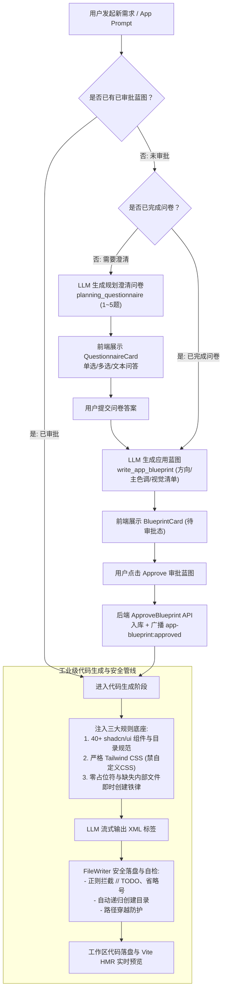

# 技术设计方案（Design）· Blot-UI v12

> 文件路径：`docs/spec/versions/v12/design.md`  
> 规范版本：v12 · 日期：2026-11-22  
> 状态：草稿 / 待确认（Reviewing）  
> 关联需求：[docs/spec/versions/v12/requirements.md](file:///Volumes/data/Nextcloud/coding/desktop/BuildUI/docs/spec/versions/v12/requirements.md)

---

## 1. 架构概览与核心数据流

本版本重构并强化 Blot-UI 的代码生成核心管线，建立“三道防线”：
1. **防线一：蓝图门禁闭环（Blueprint Gate & Questionnaire Protocol）**
2. **防线二：工业级脚手架底座硬编码注入（Scaffold & shadcn/ui 40+ Rules）**
3. **防线三：零占位符与缺失内部文件即时创建铁律（Zero Placeholder & Immediate File Creation）**

### 系统数据流图 (Mermaid)



---

## 2. 影响模块与关键改动

```
BuildUI/
├── internal/
│   ├── agent/
│   │   ├── prompt.go         # 升级 PromptAssembler: 注入工业级脚手架底座、40+ shadcn/ui 组件、严格 Tailwind、零占位符与即时建文件规范
│   │   ├── prompt_test.go    # 单元测试: 验证系统级与上下文提示词完备性
│   │   ├── model_chat.go     # 强化蓝图与问卷门禁逻辑，严格阻塞未审批写盘
│   │   ├── writer.go         # 强化 ValidateContent 占位符拦截与安全写盘
│   │   └── writer_test.go    # 单元测试: 拦截各种变体占位符与省略号代码
│   └── blueprint/
│       ├── models.go         # 完善 Questionnaire 与 BlueprintDTO 校验规范
│       └── service.go        # 完善 EnsureWriteAllowed 门禁判定
└── frontend/
    └── src/
        ├── App.tsx           # 打通问卷回答、蓝图审批至代码生成的平滑交互
        ├── components/
        │   ├── QuestionnaireCard.tsx  # 需求澄清问卷卡片
        │   └── BlueprintCard.tsx      # 应用蓝图卡片（设计方向、主色调、视觉清单、审批按钮）
        └── App.test.tsx      # 覆盖问卷提交与蓝图审批的集成测试
```

---

## 3. 提示词体系结构（Prompt Architecture）

### 3.1 工业级脚手架规范（SCAFFOLD_RULES）
注入系统提示词中，硬性告知大模型：
1. **40+ 内置 shadcn/ui 组件**：
   项目已在 `@/components/ui/` 中内置安装 40+ 个成熟组件：`accordion`, `alert`, `alert-dialog`, `aspect-ratio`, `avatar`, `badge`, `breadcrumb`, `button`, `calendar`, `card`, `carousel`, `chart`, `checkbox`, `collapsible`, `command`, `context-menu`, `dialog`, `drawer`, `dropdown-menu`, `form`, `hover-card`, `input`, `input-otp`, `label`, `menubar`, `navigation-menu`, `pagination`, `popover`, `progress`, `radio-group`, `resizable`, `scroll-area`, `select`, `separator`, `sheet`, `sidebar`, `skeleton`, `slider`, `sonner`, `switch`, `table`, `tabs`, `textarea`, `toast`, `toaster`, `toggle`, `toggle-group`, `tooltip`。
   **铁律**：严禁自行手写重复的基础 UI 原语，必须直接从 `@/components/ui/[component]` 导入！
2. **规范文件目录结构**：
   - 页面文件必须放置在 `src/pages/`（例如 `src/pages/Index.tsx`、`src/pages/NotFound.tsx`）；
   - 可复用功能组件必须放置在 `src/components/`；
   - 根路由与布局保持在 `src/App.tsx`，默认入口页面必须是 `src/pages/Index.tsx`。
3. **Tailwind CSS 独占规范**：
   - 严格使用 Tailwind CSS 工具类进行布局、间距、排版与主题配色；
   - **坚决禁止**新建任何自定义 CSS 文件（如 `.module.css`、`.css`）或在组件中插入 `<style>` 标签。
4. **图标规范**：
   - 预装 `lucide-react`，优先使用其提供的标准图标。

### 3.2 零占位符与缺失内部文件即时创建铁律（ZERO_PLACEHOLDER_AND_FILE_CREATION_RULES）
1. **零占位符铁律（Zero Placeholder Policy）**：
   - 绝对禁止 `// TODO`、`/* TODO */`、`// FIXME`、`/* implement */`、`// ... existing code`、`...` 等任何形式的代码省略号或半成品注释；
   - 每个组件必须是全功能可用（Fully Functional）的生产级完整代码，从首行到末行全量输出。
2. **缺失内部文件即时创建铁律（Immediate File Creation Policy）**：
   - 若生成的代码中 `import` 了任何当前工作区中尚不存在的内部模块、工具函数或子组件（如 `import { StatCard } from "@/components/StatCard"`），大模型**必须在同一个响应中紧接着使用 `<dyad-write path="src/components/StatCard.tsx">` 将其完整实现并落盘**；
   - 严禁引入不存在的模块，杜绝编译断链。

---

## 4. 技术选型与测试框架

| 领域 | 选型 | 选型理由 |
|---|---|---|
| 后端语言 | Go 1.26+ | 原生桌面进程、高性能并发与文件 I/O |
| 前端框架 | React 19 + TypeScript | 强类型现代化组件架构与生态 |
| 样式引擎 | Tailwind CSS v3 | 工业级样式实用工具集，消除冗余 CSS |
| UI 组件基座 | Radix UI + shadcn/ui (40+) | 无障碍、高质量、可定制的工业级预置组件体系 |
| 单元与组件测试 | Vitest + React Testing Library | 极速 ESM 测试运行器与 DOM 断言支持 |
| 后端测试 | Go `testing` 包 | Go 标准测试工具链 |
| 视觉回归测试 | Playwright MCP | 截屏取证与端到端渲染对比 |

---

## 5. 安全性说明

1. **路径穿越防护**：`FileWriter.WriteFile` 严格执行 `filepath.Clean` 与 `filepath.Abs` 根目录校验，杜绝 `..` 写入沙箱外部。
2. **未审批写盘硬阻断**：`BlueprintService.EnsureWriteAllowed` 在会话蓝图未批准时抛出 `PreconditionError`，切断任何外部或恶意的代码写盘调用。
3. **敏感占位符拒收**：`FileWriter.ValidateContent` 在写入前执行正则拦截，一旦检出 `TODO` 或半成品标识，直接阻断写入并报错。

## 6. 分步构建与恢复

审批完成后，桌面 `build` 模式请求模型生成有序 JSON 计划。规划响应独立于文件工具流。每步使用同一个构建目标、已完成步骤标题和该步读写路径的最新源码发起请求。新模块先创建，再由后续步骤接入，执行时沿用完整工具块与写盘门禁。

规划优先读取首页和直接引用的组件，把最新编辑指令作为范围，保留无关区域。模型返回无效计划或达到输出上限时，构建器自动重试规划一次。重试后仍无有效计划时，构建在创建检查点及写盘前结束。

`streamBuildStep` 保留输出限制和未闭合工具的有限续写。它验证步骤所要求的文件都已写入，再更新 SQLite 检查点。中断时已完成文件保留，重启通过 `GetProjectChat` 恢复进度。每个工程在当前应用进程内串行执行构建。

全部步骤执行后统一提交生成结果。会话历史写入与检查点删除在同一事务内完成，随后通过原有事件刷新预览。规划和续建的数据契约见 [数据设计](data.md) 与 [接口设计](api.md)。

