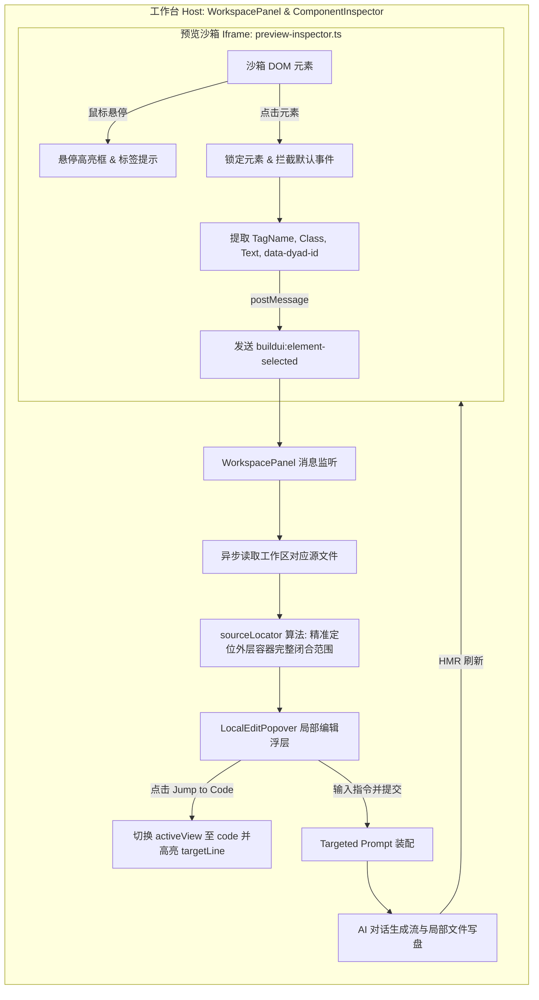

# 技术设计方案（Design）· Blot-UI v13

> 文件路径：`docs/spec/versions/v13/design.md`  
> 规范版本：v13 · 日期：2026-11-22  
> 状态：已定稿（finalized）  
> 关联需求：[docs/spec/versions/v13/requirements.md](file:///Volumes/data/Nextcloud/coding/desktop/BuildUI/docs/spec/versions/v13/requirements.md)

---

## 1. 架构概览与核心链路

本方案打通从**沙箱元素自由悬停点选**、**源码及完整外层容器代码区域智能定位**、到**局部编辑控制器呈现**、**一键切换 Code 视图**与**定向局部 AI 重构**的完整链路：



---

## 2. 核心模块与数据模型

### 2.1 元素与代码区域数据模型（`frontend/src/types/inspect.ts`）

```typescript
export interface CodeRegion {
  filePath: string;
  startLine: number;
  endLine: number;
  codeSnippet: string;
  found: boolean;
}

export interface InspectedElement {
  id: string;
  tagName: string;
  componentPath: string;
  line?: number;
  column?: number;
  className?: string;
  textSnippet?: string;
  selector?: string;
  boundingBox?: {
    x: number;
    y: number;
    width: number;
    height: number;
  };
  codeRegion?: CodeRegion;
}

export interface QuickActionPreset {
  id: string;
  label: string;
  icon?: string;
  promptTemplate: (element: InspectedElement) => string;
}
```

### 2.2 沙箱与工作台 postMessage 通信协议

| 消息类型 | 发送方 | 接收方 | Payload 结构 | 说明 |
|---|---|---|---|---|
| `buildui:inspect-mode` | WorkspacePanel | Sandbox iframe | `{ type: 'buildui:inspect-mode', active: boolean }` | 开启或关闭沙箱自由元素审查模式 |
| `buildui:element-selected` | Sandbox iframe | WorkspacePanel | `{ type: 'buildui:element-selected', element: InspectedElement }` | 用户在沙箱中点击任意元素后抛出完整元数据 |

---

## 3. 核心算法设计：`sourceLocator.ts`

根据用户确认的决策，代码定位器默认定位**该外层容器的完整起始与闭合行范围**：

```
输入:
  - sourceCode: 源文件完整文本
  - targetLine: 目标行号（1-based）
  - tagName: 可选标签名（如 button, div, section）
  - textSnippet: 可选文本摘要

算法流程:
1. 按行拆分 sourceCode，找到 targetLine 对应的文本行。
2. 若当前行不是标签起始处（例如行内只匹配到了属性或子节点），向上回溯找到该容器元素的开标签起始行 startLine（形如 <TagName ...）。
3. 使用 JSX/HTML 标签配对计数器（Tag Matching Stack）：
   - 自开标签行开始向下逐行扫描；
   - 累加同名标签的开启数，递减闭合标签 </TagName> 或自闭合 />；
   - 当计数器归零时，锁定该外层容器的完整闭合行 endLine。
4. 截取 lines[startLine-1 .. endLine-1] 合并为完整的容器代码片段 codeSnippet。
5. 返回 CodeRegion { filePath, startLine, endLine, codeSnippet, found: true }。
6. 降级方案：若 targetLine 缺失，按 tagName 与 textSnippet 搜索匹配容器；若仍未定位，返回包含临近代码的 fallback 区域，确保不抛出未捕获异常。
```

---

## 4. 局部编辑控制器 UI 与工作台联动（`LocalEditPopover.tsx` & `WorkspacePanel.tsx`）

弹窗升级包含四大核心能力：
1. **元素元数据与完整代码区域定位头**：
   - 标签与文件徽章：`<button> in src/components/Header.tsx:14-22`
2. **锁定的源代码片段折叠卡片（Code Snippet Preview）**：
   - 支持一键展开/折叠
   - 采用等宽字体与暗色高亮背景，直观呈现完整外层容器代码
3. **“Jump to Code”（在代码中查看）一键切换**：
   - 根据用户确认决策，点击后立即触发 `onViewChange('code')`；
   - 将工作区从 `preview` 切换到 `code` 视图，激活对应文件并高亮滚动到 `startLine`
4. **快捷预设与定向提示词输入**：
   - 药丸快捷动作：修改文案、调整背景色、修改内边距、圆角化、添加图标等
   - 支持 Ctrl/Cmd+Enter 提交，支持 Esc 取消

---

## 5. 定向局部 AI 提示词装配（`targetedPrompt.ts`）

提交时装配成工业级高信噪比 Prompt：

```markdown
[Target Component: src/components/Header.tsx]
[Code Region: Lines 14 to 22]
[Original Code Snippet:
```tsx
<button className="px-4 py-2 bg-blue-600 text-white rounded-lg shadow-sm">
  Get Started
</button>
```]
[Instruction: Change background color to violet-600 and make it fully rounded]
[Requirements:
1. Update ONLY this specific container element and its styling in src/components/Header.tsx.
2. Keep all surrounding components, imports, and state unchanged.
3. Use Tailwind CSS exclusively.
]
```

---

## 6. 技术选型与测试工具

- **语言与框架**：TypeScript, React, Tailwind CSS
- **单元与组件测试**：Vitest + React Testing Library
- **视觉回归与 E2E 测试**：Playwright MCP
- **代码规范**：ESLint, LF 换行符（Git .gitattributes 铁律）
