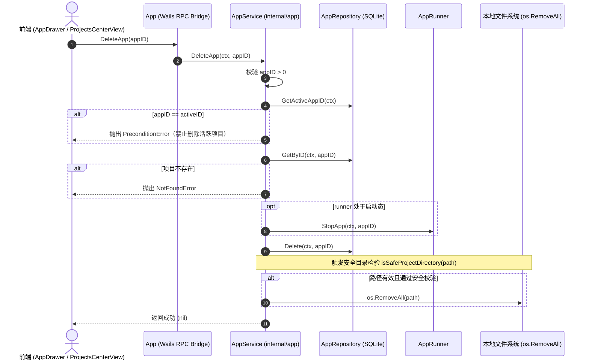

# 技术设计方案（Design）· Blot-UI v14

> 文件路径：`docs/spec/versions/v14/design.md`  
> 规范版本：v14 · 日期：2026-11-23  
> 关联需求：[docs/spec/versions/v14/requirements.md](file:///Volumes/data/Nextcloud/coding/desktop/BuildUI/docs/spec/versions/v14/requirements.md)  
> 架构宪法继承：[docs/spec/versions/v1-finished/constitution.md](file:///Volumes/data/Nextcloud/coding/desktop/BuildUI/docs/spec/versions/v1-finished/constitution.md)

---

## 1. 架构总览与交互时序

在 `AppService.DeleteApp` 方法中，原本仅调用了 `s.appRepo.Delete(ctx, appID)`。v14 增强版引入了安全目录解析与物理清理管道：



---

## 2. 核心模块与安全校验设计

### 2.1 目录安全检查器 `isSafeProjectDirectory(path string) bool`

在执行 `os.RemoveAll(path)` 之前，必须执行多重防灾屏障：

1. **空路径与相对根路径过滤**：
   - 过滤空字符串、`"."`、`"\\"` 等；
   - 规范化路径：`cleaned := filepath.Clean(path)`。

2. **绝对根目录过滤**：
   - Unix 根目录：`cleaned == "/"`；
   - Windows 卷根：`cleaned == filepath.VolumeName(cleaned)+"\\"` 或 `cleaned == filepath.VolumeName(cleaned)+"/"`。

3. **系统关键目录与用户主目录防护**：
   - 若等于用户主目录 `os.UserHomeDir()`，禁止删除；
   - 若等于当前进程运行根目录（`os.Getwd()`）或其直接父目录，禁止删除；
   - 在 Unix 下，若直接位于根目录下（如 `/bin`, `/usr`, `/etc`, `/var`, `/System`, `/Library`, `/Applications`, `/Users`），禁止删除。

4. **目录深度保障**：
   - 要求安全项目路径至少必须位于某个父目录之下（例如 `/Users/username/workspace/my-project`），其父目录不能是根目录 `/`。

```go
func isSafeProjectDirectory(dir string) bool {
    cleaned := filepath.Clean(dir)
    if cleaned == "" || cleaned == "." {
        return false
    }
    // 根目录检测
    if cleaned == "/" || cleaned == filepath.VolumeName(cleaned)+"\\" || cleaned == filepath.VolumeName(cleaned)+"/" {
        return false
    }

    // 用户主目录检测
    if home, err := os.UserHomeDir(); err == nil && home != "" {
        if cleaned == filepath.Clean(home) {
            return false
        }
    }

    // 当前工作目录检测
    if cwd, err := os.Getwd(); err == nil && cwd != "" {
        cleanCwd := filepath.Clean(cwd)
        if cleaned == cleanCwd || cleaned == filepath.Dir(cleanCwd) {
            return false
        }
    }

    // 父目录不能是根目录或自身
    parent := filepath.Dir(cleaned)
    if parent == cleaned || parent == "/" || parent == filepath.VolumeName(cleaned)+"\\" {
        return false
    }

    return true
}
```

### 2.2 容错与原子性考虑

- **物理文件不存在**：如果用户先前在文件管理器中手动移除了目录，`os.RemoveAll` 对不存在的路径返回 `nil`，这是幂等且安全的，系统正常完成数据库记录清理。
- **删除顺序**：
  先从数据库删除 `s.appRepo.Delete(ctx, appID)`，若数据库删除失败直接返回错误，不触碰磁盘；
  若数据库删除成功，再执行物理目录删除。若物理删除出现文件锁等异常，记录系统警告，但不影响工程从工作区注销。

---

## 3. 影响范围

- 后端核心服务：`internal/app/service.go`
- 后端单元测试：`internal/app/switch_test.go` 与 `internal/app/delete_dir_test.go`
- 前端交互与桥接：保持原有 RPC 契约 `DeleteApp(id: number)` 不变，前端零破坏，自然获得目录清理能力。
