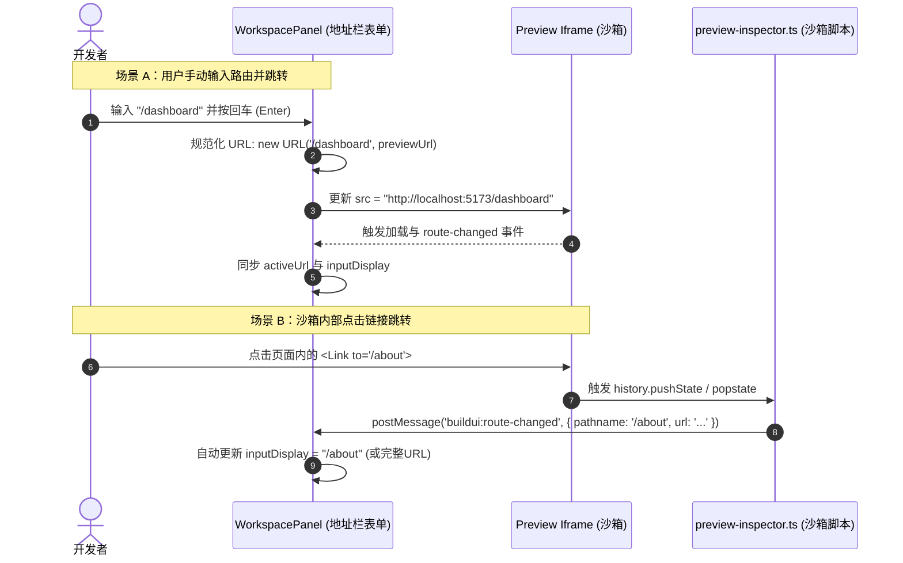

# 技术设计方案（Design）· Blot-UI v15

> 文件路径：`docs/spec/versions/v15/design.md`  
> 规范版本：v15 · 日期：2026-11-23  
> 关联需求：[docs/spec/versions/v15/requirements.md](file:///Volumes/data/Nextcloud/coding/desktop/BuildUI/docs/spec/versions/v15/requirements.md)  
> 架构宪法继承：[docs/spec/versions/v1-finished/constitution.md](file:///Volumes/data/Nextcloud/coding/desktop/BuildUI/docs/spec/versions/v1-finished/constitution.md)

---

## 1. 架构总览与交互流程



---

## 2. 核心模块与实现细节

### 2.1 地址栏改造（`WorkspacePanel.tsx`）

1. **状态管理**：
   - `activeUrl`: 当前 iframe 正在访问的目标完整 URL（默认初始化为 `previewUrl`）。
   - `addressInput`: 用户正在输入或当前呈现的地址文本。
   - 监听 `previewUrl` 变更，同步重置 `activeUrl` 与 `addressInput`。

2. **路由解析与规范化算法**：
   ```typescript
   function resolveNavigationUrl(rawInput: string, basePreviewUrl: string): string {
     const trimmed = rawInput.trim();
     if (!trimmed) return basePreviewUrl;

     // 1. 若为完整 http/https 协议
     if (/^https?:\/\//i.test(trimmed)) {
       return trimmed;
     }

     // 2. 若为相对路由或无斜杠路径 (如 "dashboard" 或 "/dashboard?tab=1#top")
     const routePath = trimmed.startsWith('/') ? trimmed : `/${trimmed}`;
     try {
       const base = basePreviewUrl || 'http://localhost:5173';
       const urlObj = new URL(routePath, base);
       return urlObj.toString();
     } catch {
       return trimmed;
     }
   }
   ```

3. **快捷键与事件交互**：
   - 表单提交 `onSubmit`: 阻止默认表单提交，解析目标 URL 并赋值给 `activeUrl`，触发 iframe 导航；
   - `Escape` 键按下：恢复 `addressInput` 为 `activeUrl`，取消未提交的更改并 blur 输入框；
   - 后退/前进按钮：尝试触发 `iframeRef.current?.contentWindow?.history.back()` 与 `forward()`。

### 2.2 沙箱路由变化捕获与同步（`preview-inspector.ts`）

在沙箱环境内增强路由拦截能力：
1. 监听全局 `popstate` 和 `hashchange` 事件；
2. 对 `win.history.pushState` 与 `win.history.replaceState` 进行轻量包裹，在每次执行原方法后分发 `buildui:route-changed`：
   ```typescript
   const notifyRouteChanged = () => {
     try {
       const loc = win.location;
       const pathname = loc.pathname + loc.search + loc.hash;
       win.parent.postMessage(
         {
           type: 'buildui:route-changed',
           pathname,
           url: loc.href,
         },
         '*'
       );
     } catch {}
   };
   ```

3. 在 `WorkspacePanel` 中监听 `buildui:route-changed` 事件，接收后自动更新 `addressInput` 与 `activeUrl`（当用户未在手动编辑聚焦态时）。

---

## 3. 影响范围

- 前端工作区组件：`frontend/src/components/WorkspacePanel.tsx`
- 前端审查脚本：`frontend/src/preview-inspector.ts` 与脚手架内同步文件 `internal/scaffold/template/src/preview-inspector.ts`
- 单元与组件测试：`frontend/src/components/WorkspacePanel.test.tsx` 与 `frontend/src/preview-inspector.test.ts`
