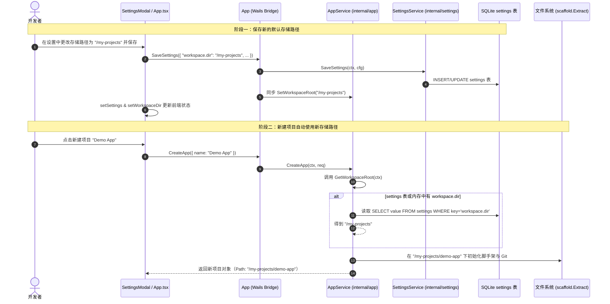

# 技术设计方案（Design）· Blot-UI v16

> 文件路径：`docs/spec/versions/v16/design.md`  
> 规范版本：v16 · 日期：2026-11-23  
> 关联需求：[docs/spec/versions/v16/requirements.md](file:///Volumes/data/Nextcloud/coding/desktop/BuildUI/docs/spec/versions/v16/requirements.md)  
> 架构宪法继承：[docs/spec/versions/v1-finished/constitution.md](file:///Volumes/data/Nextcloud/coding/desktop/BuildUI/docs/spec/versions/v1-finished/constitution.md)

---

## 1. 架构总览与调用时序



---

## 2. 核心模块与实现细节

### 2.1 `AppService.GetWorkspaceRoot(ctx context.Context) string`

在 `internal/app/service.go` 中新增动态路径解析方法：

1. **优先级规则**：
   - **最高优先级**：数据库 `settings` 表中的 `workspace.dir`（用户在设置界面显式持久化的全局偏好）；
   - **次高优先级**：内存中的 `s.workspaceRoot`（通过 `SetWorkspaceRoot` 注入的路径或测试预设）；
   - **兜底默认**：当前进程工作目录下的 `workspace` 子目录（`filepath.Join(cwd, "workspace")`）。
2. **规范化与安全**：
   - 提取后执行 `filepath.Clean(strings.TrimSpace(dir))`；
   - 确保创建目标工程目录前，父级目录自动递归创建（`os.MkdirAll(root, 0755)`）。

```go
func (s *AppService) GetWorkspaceRoot(ctx context.Context) string {
	if s.db != nil {
		var customDir string
		row := s.db.SQLDB().QueryRowContext(ctx, "SELECT value FROM settings WHERE key = 'workspace.dir';")
		if err := row.Scan(&customDir); err == nil && strings.TrimSpace(customDir) != "" {
			return filepath.Clean(strings.TrimSpace(customDir))
		}
	}
	if s.workspaceRoot != "" {
		return filepath.Clean(s.workspaceRoot)
	}
	cwd, err := os.Getwd()
	if err != nil {
		return "workspace"
	}
	return filepath.Join(cwd, "workspace")
}
```

### 2.2 `app.go` 联动增强

1. **`startup` 启动时恢复存储路径偏好**：
   在应用启动加载各 Service 时，先从 `settingsRepo` 查询 `workspace.dir`；若存在且非空，作为初始值传递给 `a.appService.SetWorkspaceRoot`。
2. **`SaveSettings` 实时同步**：
   在保存设置成功后，若配置中包含有效的 `workspace.dir`，同步调用 `a.appService.SetWorkspaceRoot`，确保无需重启进程即刻生效。
3. **`CreateAppFromTemplate` 自动补全目标路径**：
   若请求未传入 `DestPath`，通过 `a.appService.GetWorkspaceRoot` 与模版应用名拼装目标解压路径。

### 2.3 前端 `App.tsx` 与抽屉组件联动

1. 在 `App.tsx` 中保存设置回调时，提取 `newCfg['workspace.dir']` 并同步更新前端当前工作区状态 `workspaceDir`。
2. 在 `App.tsx` 中为 `AppDrawer` 传入 `onCreateNamedApp={desktop ? createDesktopProject : undefined}`，确保抽屉中的“新建应用”直接走桌面真实新建逻辑。
3. 在非桌面模拟模式下，`onCreateApp` 拼接前缀采用 `settings['workspace.dir'] || workspaceDir || '/workspace'`。

---

## 3. 影响范围

- 后端核心服务：`internal/app/service.go` 与 `internal/app/workspace_root_test.go`
- 应用生命周期与 RPC 入口：`app.go`
- 前端状态与组件：`frontend/src/App.tsx`
