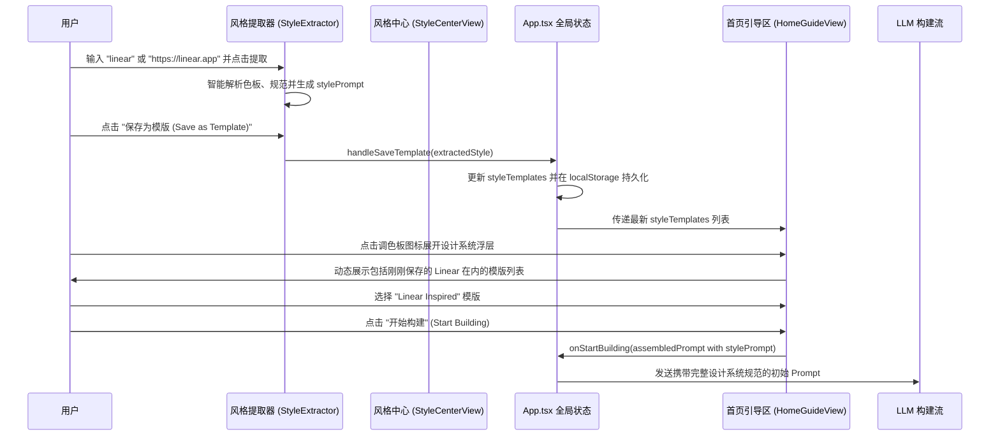

# 技术方案设计（Design）· Blot-UI v18

> 文件路径：`docs/spec/versions/v18/design.md`  
> 规范版本：v18 · 日期：2026-11-23  
> 关联需求：[docs/spec/versions/v18/requirements.md](file:///Volumes/data/Nextcloud/coding/desktop/BuildUI/docs/spec/versions/v18/requirements.md)

---

## 1. 架构总览与数据模型

### 1.1 数据结构升级 (`frontend/src/types/style.ts`)

```typescript
export interface ColorPalette {
  primary: string;           // 主品牌/强调色 (如 #5e6ad2)
  accent?: string;           // 次要高亮/发光色 (如 #8792e8)
  background: string;        // 画布底色 (如 #08090a)
  surface: string;           // 卡片与浮层表面色 (如 #121316)
  text: string;              // 主文本色 (如 #f7f8f8)
  textMuted?: string;        // 次要辅助文本色 (如 #8a8f98)
  border: string;            // 边框描边色 (如 #222326)
}

export interface ExtractedStyle {
  id: string;
  name: string;
  referenceSource: string;   // 参照源（如 'Linear', 'Stripe', 'https://linear.app'）
  palette: ColorPalette;
  borderRadius: 'sm' | 'md' | 'lg' | 'xl' | '2xl' | 'full';
  typography: string;
  tags: string[];
  stylePrompt: string;       // 详细工业级设计系统 Prompt
  designPrompt?: string;     // 向后兼容旧字段
  createdAt: string;
}

export interface StyleTemplate extends ExtractedStyle {
  isPreset?: boolean;
  description?: string;
}
```

---

## 2. 标杆级风格提取知识库与智能推导引擎

### 2.1 标杆网站真实知识库示例

1. **Linear (`linear.app`)**:
   - 风格特征: 极致暗黑黑曜石质感、极细 1px 微光边框、高饱和紫靛色 Accent、紧凑信息密度、Inter 字体。
   - 提取参数: Primary `#5e6ad2`, Accent `#8792e8`, Background `#08090a`, Surface `#121316`, Text `#f7f8f8`, TextMuted `#8a8f98`, Border `#222326`, Radius `xl`, Typography `Inter, system-ui, sans-serif`.
2. **Stripe (`stripe.com`)**:
   - 风格特征: 高对比 SaaS 明亮极简、渐变弥散光感、深邃靛蓝搭配薄荷绿 Accent、圆润大卡片。
   - 提取参数: Primary `#635bff`, Accent `#00d4aa`, Background `#ffffff`, Surface `#f6f9fc`, Text `#0a2540`, TextMuted `#425466`, Border `#e6ebf1`, Radius `2xl`.
3. **Supabase (`supabase.com`)**:
   - 风格特征: 极客深色开发者工具、黑灰表面与高亮翡翠绿、单色极简。
   - 提取参数: Primary `#3ecf8e`, Accent `#24b47e`, Background `#1c1c1c`, Surface `#242424`, Text `#ededed`, Border `#343434`, Radius `lg`.
4. **Vercel (`vercel.com`)**:
   - 风格特征: 极简纯黑白高密度、锋利几何边界、Geist 字体。
   - 提取参数: Primary `#000000`, Accent `#0070f3`, Background `#ffffff`, Surface `#fafafa`, Text `#171717`, Border `#eaeaea`, Radius `md`.

### 2.2 智能推导引擎
当用户输入任意 URL（如通过正则提取 host 关键词）或输入任意自然语言需求（如 "warm coffee shop"）时：
- 解析关键词：识别暗黑/明亮、冷色/暖色、行业属性（Fintech, Developer, Creative, Minimal）；
- 基于语义哈希推导生成符合 WCAG 对比度标准的色彩矩阵，保证文字与底色、卡片与边框的极致协调。

### 2.3 结构化 Style Prompt 构建器
生成的 `stylePrompt` 模板：
```markdown
# Design System Specification: [Name]
[Visual Identity & Atmosphere]
- Aesthetic Tone: [Tags]
- Inspired By: [Reference]

[Color Palette Tokens]
- Primary Brand Accent: [Primary] (Tailwind text/bg highlight)
- Secondary Accent: [Accent]
- Canvas Background: [Background]
- Card & Surface: [Surface]
- Border & Stroke: [Border]
- Typography Primary: [Text], Muted: [TextMuted]

[Layout & Component Directives]
- Border Radius: rounded-[Radius] for all cards, dialogs and interactive buttons
- Card Styling: bg-[Surface] with 1px border border-[Border] and soft ambient shadow
- Primary Button: bg-[Primary] text-white hover:brightness-110 shadow-sm
- Typography: Use [Typography] with tight tracking on headings
- Tailwind Directives: Strictly adhere to the tokens above for layout, surfaces, and contrast.
```

---

## 3. 首页与风格模版联动流程



---

## 4. 响应式与持久化设计

- **持久化键名**: `blot_style_templates`（保存在 `localStorage` 中，初始化时合并系统内置标杆模版与用户提取模版）。
- **统一模版适配器**: `ThemePreset` 与 `StyleTemplate` 进行属性对齐，`primary`、`background`、`surface`、`text`、`border` 以及 `stylePrompt` 互通，确保在 Header 主题选择器、风格页与首页中表现完全一致。
