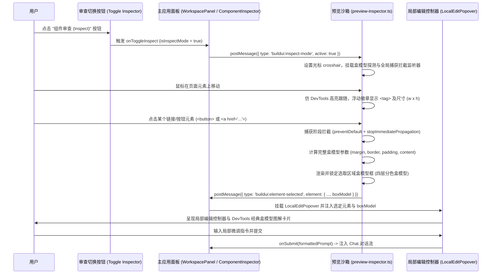

# v19 技术方案设计 (Design)

> 规范版本：v19 · 创建日期：2026-11-23  
> 涉及模块：`preview-inspector.ts`、`types/inspect.ts`、`ComponentInspector.tsx`、`LocalEditPopover.tsx`、`WorkspacePanel.tsx`

---

## 1. 架构与交互流程



---

## 2. 数据结构设计 (`types/inspect.ts`)

```typescript
export interface BoxModelMetrics {
  margin: { top: number; right: number; bottom: number; left: number };
  border: { top: number; right: number; bottom: number; left: number };
  padding: { top: number; right: number; bottom: number; left: number };
  content: { width: number; height: number };
  rect: { top: number; left: number; width: number; height: number; x: number; y: number };
}

export interface InspectedElement {
  id: string;
  tagName: string;
  componentPath: string;
  line?: number;
  column?: number;
  className?: string;
  textSnippet?: string;
  boundingBox?: {
    x: number;
    y: number;
    width: number;
    height: number;
  };
  boxModel?: BoxModelMetrics;
  codeRegion?: {
    filePath: string;
    startLine: number;
    endLine: number;
    codeSnippet: string;
    found: boolean;
  };
}
```

---

## 3. 仿浏览器 DevTools 盒模型框设计与视觉规范

### 3.1 沙箱内盒模型视觉分层
参考 Chrome DevTools 规范配色：
- **Margin（外边距）**: `rgba(249, 152, 73, 0.35)`（暖橙色，虚线/半透明底）
- **Border（边框）**: `rgba(254, 216, 118, 0.65)`（明黄色，实线边）
- **Padding（内边距）**: `rgba(149, 213, 139, 0.4)`（柔和浅绿）
- **Content（内容区）**: `rgba(131, 182, 242, 0.45)`（浅青蓝）
- **浮动信息 Badge**:
  - 位置：跟随在元素顶部或下翻，深色胶囊背景 (`#1e293b` / `rgba(15, 23, 42, 0.9)`)，白色文字。
  - 内容：`<tagName.class>` `120 × 36`，并标注源码文件位置。

### 3.2 盒模型计算算法
通过 `window.getComputedStyle(el)` 解析：
- `parsePx(val)`：将 `"16px"` 转为数值 `16`。
- `contentWidth = rect.width - (borderLeft + borderRight + paddingLeft + paddingRight)`
- `contentHeight = rect.height - (borderTop + borderBottom + paddingTop + paddingBottom)`

### 3.3 严格防跳转拦截机制
在沙箱内部注册捕获阶段（`capture: true`）的事件处理器：
- 拦截事件：`click`、`auxclick`、`submit`。
- 无论目标元素是原生 `<a href="...">`、携带表单动作的 `<button type="submit">`、还是通过 React/Vue 绑定的事件委托，均在冒泡之前拦截，确保页面 DOM 保持静止。

---

## 4. 局部编辑控制器图解卡片 (Box Model Diagram Widget)

在 `LocalEditPopover.tsx` 中嵌入可折叠/常驻的 DevTools 经典同心盒模型图解：
- 四层同心卡片（Margin -> Border -> Padding -> Content）。
- 实时展示上下左右四个方向的像素值与内容尺寸，为用户进行定向样式描述提供直观参考。
