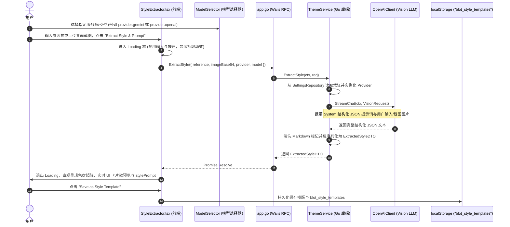

# v20 技术设计方案 (Design)

> 规范版本：v20 · 创建日期：2026-11-23  
> 目标模块：`internal/theme`、`app.go`、`frontend/src/components/StyleExtractor.tsx`、`frontend/src/components/StyleCenterView.tsx`、`frontend/src/components/ModelSelector.tsx`

---

## 1. 架构总览与交互流



---

## 2. 后端数据结构与 RPC 设计

### 2.1 请求与响应模型 (`internal/theme/style.go`)

```go
package theme

// ExtractStyleRequest 风格提取请求
type ExtractStyleRequest struct {
	Reference   string `json:"reference"`             // 参照物 URL、品牌名或风格需求
	ImageBase64 string `json:"imageBase64,omitempty"` // 可选截图 Base64 DataURL (用于 Vision 多模态)
	Provider    string `json:"provider,omitempty"`    // 指定模型服务商 (如 "openai", "gemini" 或留空 "auto")
	Model       string `json:"model,omitempty"`       // 指定具体模型标识符
}

// ColorPaletteDTO 色彩调色板
type ColorPaletteDTO struct {
	Primary    string `json:"primary"`
	Accent     string `json:"accent"`
	Background string `json:"background"`
	Surface    string `json:"surface"`
	Text       string `json:"text"`
	TextMuted  string `json:"textMuted"`
	Border     string `json:"border"`
}

// ExtractedStyleDTO 风格提取返回结构体
type ExtractedStyleDTO struct {
	ID              string          `json:"id"`
	Name            string          `json:"name"`
	ReferenceSource string          `json:"referenceSource"`
	Palette         ColorPaletteDTO `json:"palette"`
	BorderRadius    string          `json:"borderRadius"`
	Typography      string          `json:"typography"`
	Tags            []string        `json:"tags"`
	StylePrompt     string          `json:"stylePrompt"`
	DesignPrompt    string          `json:"designPrompt"`
	CreatedAt       string          `json:"createdAt"`
}
```

### 2.2 核心服务方法实现 (`internal/theme/theme.go`)
* `ThemeService` 接收 `SettingsRepository` 依赖；
* `ExtractStyle(ctx context.Context, req ExtractStyleRequest) (*ExtractedStyleDTO, error)`：
  1. 校验输入（`Reference` 与 `ImageBase64` 至少提供一项）；
  2. 根据 `req.Provider` 与 `req.Model` 解析并载入 LLM 客户端（复用现有凭证加载逻辑）；
  3. 构建 System Prompt 与包含图片多模态格式的 `llm.ChatMessage`；
  4. 发起调用，收集并清洗输出中的 JSON 文本；
  5. 校验色盘必要字段（缺失时做基础补全）；
  6. 组装并返回 `ExtractedStyleDTO`。

---

## 3. 前端交互设计与组件集成

### 3.1 `StyleExtractor.tsx`
* **模型选择器集成**：在输入卡片顶部增加服务商/模型选择下拉框（直接引入现有 `ModelSelector`）；
* **受控状态管理**：
  * `selectedModel`: 当前选中的服务商/模型（默认为 `'auto'`）；
  * `isExtracting`: 布尔值，控制加载中动画与表单禁用；
  * `extractError`: 字符串，展示大模型调用失败的错误原因（提供前往设置的跳转按钮）；
* **调用 Wails RPC**：
  * 在客户端优先调用 `desktopApp().ExtractStyle(...)`；
  * 提取成功后更新 `extractedResult`，并展示多色盘、UI 卡片预览与完整 `stylePrompt`；
  * 若处于非桌面浏览器环境（单元测试或离线模式），优雅降级至本地 `extractStyleFromReference`。

### 3.2 `StyleCenterView.tsx` 与 `App.tsx`
* `StyleCenterView` 向 `StyleExtractor` 传递 `settings`、`onOpenSettings`、`selectedModel` 与 `onSelectModel`；
* 用户保存模版时，将 `ExtractedStyleDTO` 转为 `ThemePreset` 并持久化到 `blot_style_templates`。

---

## 4. Prompt 工程设计

```text
You are an elite Design System Architect and Principal UI Engineer.
Analyze the provided visual reference (brand name, URL, design aesthetic description, or screenshot image).
Extract and formalize its visual design system and return ONLY a valid JSON object matching this exact schema:
{
  "name": "Design system name (e.g. 'Linear Dark', 'Stripe Fintech', 'Obsidian Minimal')",
  "palette": {
    "primary": "#hex (main brand accent)",
    "accent": "#hex (secondary highlight or glow)",
    "background": "#hex (main canvas background)",
    "surface": "#hex (card/panel surface)",
    "text": "#hex (high-contrast body/heading text)",
    "textMuted": "#hex (secondary subtext)",
    "border": "#hex (subtle hairline border)"
  },
  "borderRadius": "sm" | "md" | "lg" | "xl" | "2xl" | "full",
  "typography": "font family stack (e.g. 'Inter, system-ui, sans-serif')",
  "tags": ["Tag1", "Tag2", "Tag3"],
  "stylePrompt": "A comprehensive industrial-grade design system prompt containing: 1. Visual Language & Identity 2. Color Palette Tokens 3. Layout & Component Directives (cards, buttons, borders, blur) 4. Tailwind Implementation Directives."
}
Strict Rule: Return ONLY the raw JSON object. Do not wrap with conversational text or markdown code fences outside JSON.
```
