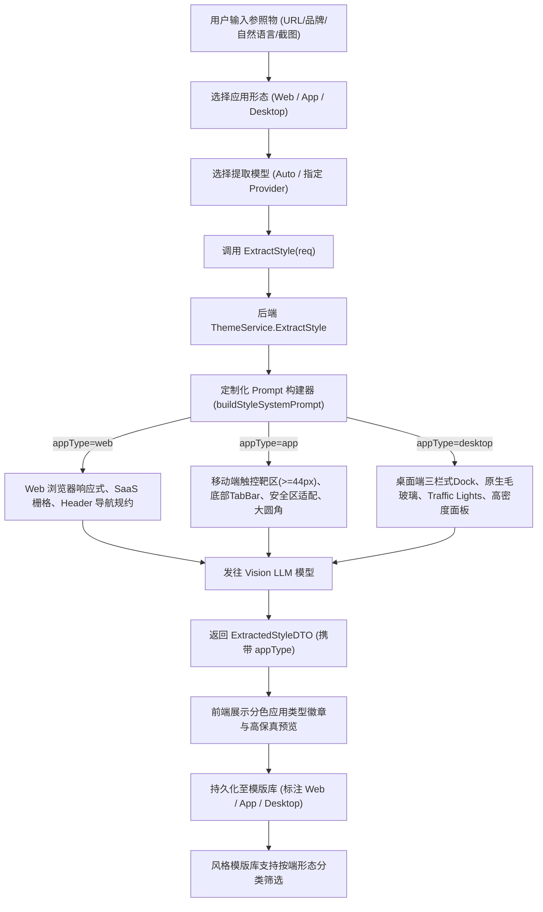

# v21 技术方案设计 (Design)

> 规范版本：v21 · 创建日期：2026-11-23  
> 目标模块：`internal/theme/style.go`、`frontend/src/types/style.ts`、`frontend/src/components/StyleExtractor.tsx`、`frontend/src/components/StyleCenterView.tsx`、`frontend/src/utils/styleExtractor.ts`

---

## 1. 架构总览与多端形态定制流



---

## 2. 数据结构设计与接口升级

### 2.1 Go 后端 (`internal/theme/style.go`)

```go
type ExtractStyleRequest struct {
	Reference   string `json:"reference"`
	ImageBase64 string `json:"imageBase64,omitempty"`
	Provider    string `json:"provider,omitempty"`
	Model       string `json:"model,omitempty"`
	AppType     string `json:"appType,omitempty"` // "web" | "app" | "desktop"，默认为 "web"
}

type ExtractedStyleDTO struct {
	ID              string          `json:"id"`
	Name            string          `json:"name"`
	AppType         string          `json:"appType"` // "web" | "app" | "desktop"
	ReferenceSource string          `json:"referenceSource"`
	Palette         ColorPaletteDTO `json:"palette"`
	BorderRadius    string          `json:"borderRadius"`
	Typography      string          `json:"typography"`
	Tags            []string        `json:"tags"`
	StylePrompt     string          `json:"stylePrompt"`
	DesignPrompt    string          `json:"designPrompt"`
	CreatedAt       string          `json:"createdAt"`
}
```

### 2.2 前端 TypeScript 类型 (`frontend/src/types/style.ts` & `ThemeSelector.tsx`)

```typescript
export type StyleAppType = 'web' | 'app' | 'desktop';

export interface ExtractedStyle {
  id: string;
  name: string;
  appType?: StyleAppType;
  referenceSource: string;
  palette: ColorPalette;
  borderRadius: 'sm' | 'md' | 'lg' | 'xl' | '2xl' | 'full';
  typography: string;
  tags: string[];
  stylePrompt?: string;
  designPrompt: string;
  createdAt: string;
}

export interface ThemePreset {
  id: string;
  name: string;
  appType?: StyleAppType;
  // ... 其他已有字段保持完全兼容
}
```

---

## 3. 定制化 System Prompt 引擎设计

根据传入的 `appType`，构建领域强约束的引导规范：

```text
# Web 模式 (appType == "web")
Platform Target: Modern Web Application (Responsive Browser SaaS, Portals & Dashboards).
- Layout: Responsive desktop & tablet grid, accessible top navigation header, adaptive multi-column content.
- Cards & Containers: Systemic 'rounded-xl' cards with subtle ambient drop shadows (shadow-sm).
- Hover & States: Explicit hover/active cursor states, interactive table rows, micro-transitions.
- Tailwind Directives: Standard utility classes adhering to desktop and responsive browser viewports.

# App 模式 (appType == "app")
Platform Target: Mobile Application (iOS Human Interface Guidelines & Android Material 3).
- Touch Target: Strictly minimum 44x44px for buttons, chips, and tappable list items.
- Corners & Geometry: Emphasize 'rounded-2xl' or 'rounded-3xl' for natural mobile thumb reach.
- Navigation & Structure: Prominent bottom TabBar navigation, compact top navigation bar, safe-area top/bottom insets.
- Typography: Mobile-optimized typography stack with generous line heights and high legibility.

# Desktop 模式 (appType == "desktop")
Platform Target: Desktop Native Application (macOS Tahoe & Windows Fluent Workstation).
- Structure: 3-column split workstation, collapsible left sidebar/dock, integrated titlebar with native window controls / traffic lights.
- Materials: Flat obsidian surfaces with soft backdrop blur (backdrop-blur-md) and crisp 1px hairline dividers.
- Density: High information density suitable for mouse & keyboard productivity, with keyboard shortcut hints (kbd badges).
- Typography: Crisp system fonts (SF Pro / Segoe UI / Inter) with tight letter tracking.
```

---

## 4. 前端交互与视觉设计

### 4.1 风格提取器 (`StyleExtractor.tsx`)
* 在“参照物输入”与“模型选择器”之间，增设**应用类型单选胶囊组（Segmented Control）**：
  * `Globe` **Web** (默认)
  * `Smartphone` **App**
  * `Monitor` **Desktop**
* 提取结果呈现卡片与 Live UI 预览顶部，展示带有小图标的应用类型徽章（Badge），分色清晰辨识。

### 4.2 风格中心模版库 (`StyleCenterView.tsx`)
* **模版卡片标注**：每个模版卡片右上角渲染该风格所属的平台类型徽章（`Web` 浅蓝 / `App` 浅紫 / `Desktop` 浅绿），历史模版及内置预设若未指定则默认为 `Web`（系统内置的 macOS Tahoe Blue 预设标注为 `Desktop`）。
* **形态筛选工具栏**：在模版库上方提供过滤胶囊：`全部 (All)` / `Web` / `App` / `Desktop`，方便用户按应用形态极速查找所需设计模版。
