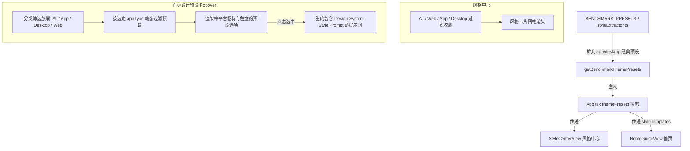

# v23 经典多端风格扩充与首页预设分类显示技术方案设计

## 1. 架构与数据流分析

## 2. 详细设计要点

### 2.1 风格与预设类型定义扩展 (`types/style.ts` & `utils/styleExtractor.ts`)
1. `PresetDefinition` 接口增加 `appType: StyleAppType;` 属性。
2. `BENCHMARK_PRESETS` 扩充：
   - App: `ios-health`, `threads`, `duolingo`, `cashapp`。
   - Desktop: `windows-fluent`, `slack`, `vscode`，并将 `apple`, `raycast` 标为 `desktop`。
   - Web: `linear`, `stripe`, `supabase`, `vercel`, `airbnb`, `github`, `notion`。
3. `getBenchmarkThemePresets` 映射逻辑更新为：直接读取 `item.appType || 'web'`，并调用 `buildDesignSystemPrompt` 传入相应 `appType`，生成针对移动端/桌面端专属的架构指令。

### 2.2 首页设计预设分类显示 (`components/HomeGuideView.tsx`)
1. `StyleOption` 增加 `appType?: AppCategory;` 字段。
2. `DEFAULT_STYLE_PRESETS` 赋予每个选项对应的 `appType`，并添加移动端与桌面经典预设作为默认后备。
3. `effectivePresets` 映射外部 `styleTemplates` 时提取 `appType: item.appType || (item.id === 'macos' ? 'desktop' : 'web')`。
4. 首页风格选择 Popover 内部状态：
   - 新增 `popoverCategoryFilter: 'all' | AppCategory` 状态，默认根据当前首页选中的 `category`（如当前正处在 App 模式，点击后智能推荐或用户可自由切换 All / App / Desktop / Web）。
   - 顶部提供微型胶囊筛选条：
     - `guide-style-filter-all`
     - `guide-style-filter-app`
     - `guide-style-filter-desktop`
     - `guide-style-filter-web`
   - 过滤条件：`popoverCategoryFilter === 'all' || preset.appType === popoverCategoryFilter`。
   - 选项右侧/左侧显示对应平台的形态标签或图标。

### 2.3 国际化与文案 (`i18n`)
- 确保相关文案使用标准国际化键或一致的英文/中文展示，中文界面下提供精准标签。
