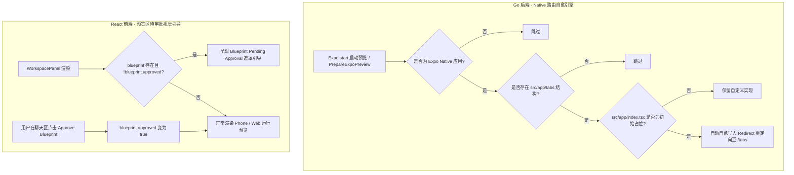

# v24 移动端路由自愈保障与蓝图待审批预览引导技术方案设计

## 1. 架构与数据流分析



## 2. 详细设计要点

### 2.1 Native 路由自愈实现 (`internal/scaffold/expo_preview.go` & `internal/workspace`)
1. 在 `internal/scaffold/expo_preview.go` 中，在准备 Expo 预览配置时，调用 `AutoHealNativeEntry(project string) error`：
   - 检查 `filepath.Join(project, "src/app/index.tsx")` 是否存在。
   - 检查是否存在 `filepath.Join(project, "src/app/(tabs)")`。
   - 读取 `src/app/index.tsx` 内容，判断是否包含指纹 `Your app is ready to build`。
   - 如果满足条件，自动写盘标准重定向：
     ```tsx
     import { Redirect } from 'expo-router';

     export default function Index() {
       return <Redirect href="/(tabs)" />;
     }
     ```
2. 在 `internal/agent/native_prompt.go` 中增强提示词：
   - 更新 `nativeRouterScaffold`：
     ```
     When using a (tabs) route group, rewrite src/app/index.tsx to redirect root traffic with <Redirect href="/(tabs)" /> from expo-router. Never leave the placeholder HomeScreen in src/app/index.tsx.
     ```

### 2.2 前端预览待审批引导层 (`frontend/src/components/WorkspacePanel.tsx`)
1. 属性扩展：`WorkspacePanel` 接收 `blueprint?: BlueprintDTO | null;`
2. 条件渲染：
   - 当 `blueprint && !blueprint.approved` 时，在预览视口内（或在 Phone 容器内部）渲染引导层：
     - 图标：`Clock` 或 `FileCode`
     - 徽章：`Pending Approval`
     - 标题：`Blueprint Pending Approval` / 国际化 `t('blueprint.pendingApproval')`
     - 说明文案：`Review the blueprint and click "Approve Blueprint" in the conversation to start building your application.`
   - 容器样式与明暗主题保持一致，带磨砂玻璃效果（`backdrop-blur-sm`），既展示手机框架，又明确传达待审批状态。
