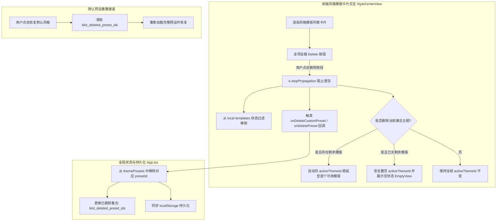

# v25 风格页模版列表全项删除功能技术方案设计

## 1. 架构与数据流设计



## 2. 详细设计要点

### 2.1 StyleCenterView.tsx 改造
1. **删除按钮条件放开**：
   - 移除原来的 `{isCustom && ( ... )}` 门槛，对 `templates.map((preset) => ...)` 中的每一个卡片无条件渲染删除按钮。
   - 按钮属性：
     - `data-testid={`delete-template-btn-${preset.id}`}`
     - `type="button"`
     - `title={t('stylePage.btnDeleteTemplate')}`
     - `aria-label={`Delete ${preset.name}`}`
     - `className="p-1 rounded-lg text-slate-400 hover:text-rose-500 dark:hover:text-rose-400 hover:bg-slate-100 dark:hover:bg-zinc-800 transition-colors opacity-70 hover:opacity-100 group-hover:opacity-100"`
2. **删除处理逻辑优化 (`handleDeleteTemplate`)**：
   ```tsx
   const handleDeleteTemplate = (id: string, e: React.MouseEvent) => {
     e.stopPropagation();
     const nextTemplates = templates.filter((t) => t.id !== id);
     setTemplates(nextTemplates);
     onDeleteCustomPreset?.(id);
     if (activeThemeId === id) {
       if (nextTemplates.length > 0) {
         onSelectTheme(nextTemplates[0].id);
       } else {
         onSelectTheme('');
       }
     }
   };
   ```
3. **空状态优雅降级**：
   - 当 `displayedTemplates.length === 0` 时，渲染空状态组件，展示 `Layers` 或 `Palette` 图标、多语言提示信息与可选的“恢复默认预设”按钮（`onRestoreDefaultPresets`）。

### 2.2 App.tsx 预设删除与持久化联动
1. **删除 ID 存储键**：`const DELETED_PRESETS_STORAGE_KEY = 'blot_deleted_preset_ids';`
2. **初始化过滤**：
   - 初始化 `themePresets` 时，读取 `localStorage.getItem(DELETED_PRESETS_STORAGE_KEY)`，过滤掉已被用户删除的内置或标杆 ID。
3. **删除回调联动**：
   - `handleDeleteCustomPreset(presetId)`：
     - 更新 `themePresets` 状态。
     - 若不是纯自定义模版，将其记录入 `DELETED_PRESETS_STORAGE_KEY`。
     - 保存剩余自定义模版到 `STYLE_TEMPLATES_STORAGE_KEY`。
4. **重置恢复函数**：
   - `handleRestoreDefaultPresets()`：清空 `DELETED_PRESETS_STORAGE_KEY`，重新恢复所有内置与基准预设。

### 2.3 多语言国际化 i18n 补充
在 `frontend/src/i18n/types.ts`、`en.ts`、`zh.ts` 中的 `stylePage` 命名空间下补充：
- `btnDeleteTemplate`: 'Delete style template' / '删除风格模版'
- `emptyTitle`: 'No style templates available' / '暂无可用风格模版'
- `emptyDesc`: 'All style templates in this category have been removed.' / '该分类下的风格模版已被全部移除。'
- `btnRestoreDefaults`: 'Restore default styles' / '恢复默认风格预设'
