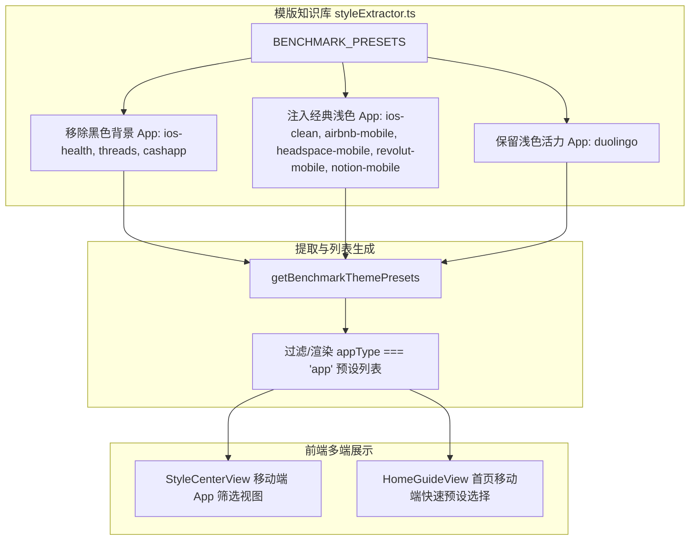

# v26 风格与设计中心移动端 App 风格模版重构技术方案设计

## 1. 架构与模版数据流

## 2. 经典移动端 App 风格规范定义

| Preset Key | 风格名称 | 背景色 (Background) | 表面卡片 (Surface) | 品牌主色 (Primary) | 圆角 | 风格定位 |
|------------|---------|---------------------|-------------------|-------------------|:----:|---------|
| `ios-clean` | iOS Modern Clean | `#f2f2f7` | `#ffffff` | `#007aff` | `2xl` | 经典 Apple HIG 系统级规范 |
| `airbnb-mobile` | Airbnb Mobile | `#ffffff` | `#f7f7f7` | `#ff385c` | `2xl` | 精致生活旅行度假卡片流 |
| `headspace-mobile` | Headspace Mindful | `#fcf8f2` | `#ffffff` | `#f47d31` | `2xl` | 温润燕麦米白、治愈正念冥想 |
| `revolut-mobile` | Revolut NeoBank | `#f8f9fa` | `#ffffff` | `#1969ff` | `2xl` | 现代轻量金融科技与资产看板 |
| `notion-mobile` | Notion Mobile | `#ffffff` | `#f7f6f3` | `#2e3035` | `xl` | 纯净纸感白底与沉着石墨灰笔记 |
| `duolingo` | Duolingo Mobile | `#ffffff` | `#f7f7f7` | `#58cc02` | `2xl` | 活力趣味游戏化学习微动效 |

## 3. 具体修改方案

### 3.1 `frontend/src/utils/styleExtractor.ts`
- 移除 `ios-health`, `threads`, `cashapp`。
- 新增 `ios-clean`, `airbnb-mobile`, `headspace-mobile`, `revolut-mobile`, `notion-mobile` 的完整定义，包含丰富的 aliases、ColorPalette、tags、borderRadius、typography 和精确的 `buildDesignSystemPrompt` 生成支持。

### 3.2 `frontend/src/components/HomeGuideView.tsx`
- 替换 `QUICK_STYLE_PRESETS` 中的移动端预设卡片：
  - 移除 `apple-health` 与 `threads-mobile`；
  - 引入 `ios-clean`（iOS Modern Clean）与 `airbnb-mobile`（Airbnb Mobile），色彩指示圈采用专属标志色。

### 3.3 测试断言适配
- `styleExtractor.test.ts`：增加检查所有 `appType === 'app'` 的模版其 `palette.background !== '#000000'`，验证无黑底，并测试新预设的提取。
- `StyleCenterView.test.tsx`：更新 App 筛选断言为新经典风格。
