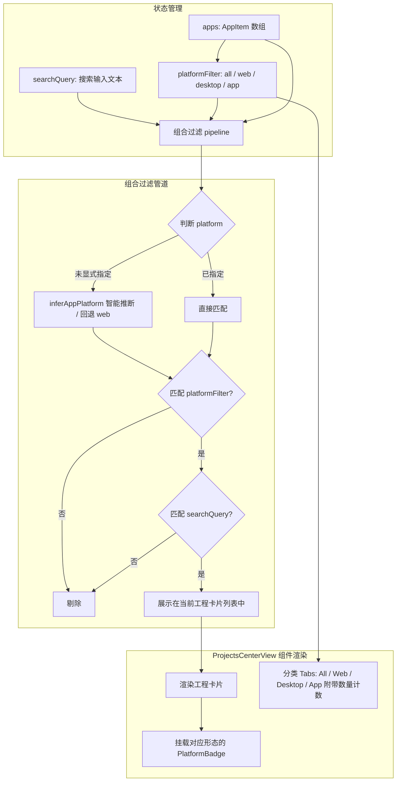

# v27 工程管理页按 Web、Desktop、App 分类显示技术方案设计

## 1. 架构与数据流设计



## 2. 详细技术实现

### 2.1 数据结构扩展 (`frontend/src/components/AppDrawer.tsx`)
```ts
export type ProjectPlatform = 'web' | 'desktop' | 'app';

export interface AppItem {
  id: number;
  name: string;
  path: string;
  createdAt?: string;
  platform?: ProjectPlatform;
}
```

### 2.2 平台智能推断算法 (`inferAppPlatform`)
```ts
export const inferAppPlatform = (app: Partial<AppItem>): ProjectPlatform => {
  if (app.platform) return app.platform;
  const combined = `${app.name || ''} ${app.path || ''}`.toLowerCase();
  if (combined.includes('desktop') || combined.includes('wails') || combined.includes('electron')) {
    return 'desktop';
  }
  if (
    combined.includes('app') ||
    combined.includes('native') ||
    combined.includes('expo') ||
    combined.includes('mobile') ||
    combined.includes('ios') ||
    combined.includes('android')
  ) {
    return 'app';
  }
  return 'web';
};
```

### 2.3 分类过滤与卡片形态 Badge (`ProjectsCenterView.tsx`)
1. **分类选项卡设计**：
   - 使用与 `TemplateCenterView` 一致的胶囊 Tab：
     - `data-testid="project-filter-all"`
     - `data-testid="project-filter-web"`
     - `data-testid="project-filter-desktop"`
     - `data-testid="project-filter-app"`
   - 带有数量角标 `counts.all`、`counts.web`、`counts.desktop`、`counts.app`。
2. **卡片 Badge 渲染**：
   ```tsx
   const renderPlatformBadge = (platform: ProjectPlatform) => {
     switch (platform) {
       case 'desktop':
         return (
           <span
             data-testid={`project-platform-badge-${app.id}`}
             className="inline-flex items-center gap-1 px-2 py-0.5 rounded-full text-[10px] font-medium bg-purple-50 text-purple-700 dark:bg-purple-950/40 dark:text-purple-300 border border-purple-200/60 dark:border-purple-800/60"
           >
             <Monitor className="w-3 h-3" />
             <span>{t('projectsPage.platformDesktop')}</span>
           </span>
         );
       case 'app':
         return (
           <span
             data-testid={`project-platform-badge-${app.id}`}
             className="inline-flex items-center gap-1 px-2 py-0.5 rounded-full text-[10px] font-medium bg-emerald-50 text-emerald-700 dark:bg-emerald-950/40 dark:text-emerald-300 border border-emerald-200/60 dark:border-emerald-800/60"
           >
             <Smartphone className="w-3 h-3" />
             <span>{t('projectsPage.platformApp')}</span>
           </span>
         );
       case 'web':
       default:
         return (
           <span
             data-testid={`project-platform-badge-${app.id}`}
             className="inline-flex items-center gap-1 px-2 py-0.5 rounded-full text-[10px] font-medium bg-blue-50 text-blue-700 dark:bg-blue-950/40 dark:text-blue-300 border border-blue-200/60 dark:border-blue-800/60"
           >
             <Globe className="w-3 h-3" />
             <span>{t('projectsPage.platformWeb')}</span>
           </span>
         );
     }
   };
   ```
3. **新建工程表单扩展**：
   - 在新建卡片中增加形态选择器（Web / Desktop / App），默认选中当前激活的 `platformFilter`（如果处于 `all` 则默认为 `web`）。
   - 调用 `onCreateNamedApp?.(name, selectedPlatform)`。

### 2.4 多语言 i18n 扩展
在 `projectsPage` 命名空间下增加：
- `tabAll`: 'All' / '全部'
- `tabWeb`: 'Web' / 'Web 应用'
- `tabDesktop`: 'Desktop' / '桌面端'
- `tabApp`: 'App' / '移动端'
- `platformWeb`: 'Web' / 'Web 应用'
- `platformDesktop`: 'Desktop' / '桌面端'
- `platformApp`: 'Mobile App' / '移动端 App'
- `newProjectPlatformLabel`: 'Project Platform' / '应用形态'
