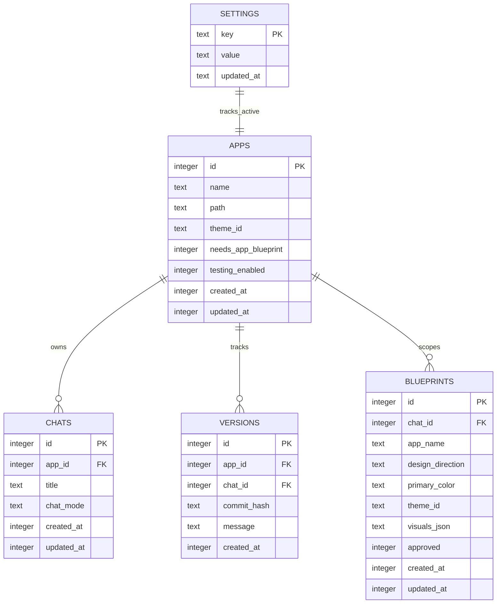

# 数据与存储设计说明书（Data）· Blot-UI v3

> 文件路径：`docs/spec/versions/v3/data.md`  
> 规范版本：v3 · 日期：2026-11-21  
> 关联设计：[design.md](design.md)  
> 继承规则：`docs/spec/steering/` 与 `docs/spec/versions/v1-finished/data.md`  
> 核心驱动：Go 纯 Go SQLite (`modernc.org/sqlite`)

---

## 1. 存储架构全景

Blot-UI v3 在 v1 和 v2 数据模型之上，增强多应用活动状态追踪与物理级联清理保障：



---

## 2. 模式增强与设计细节

### 2.1 活跃应用状态管理 (`app.active_id`)

在已有 `settings` 键值表中存储当前用户活动的工程 ID：
- **键名**：`app.active_id`
- **值**：整数 ID 字符串（如 `"1"`）
- **生命周期**：
  - 应用首次启动时，若 `app.active_id` 为空，默认选取 `apps` 表中的第一项作为活跃应用；
  - 当调用 `SwitchApp(appID)` 时，原子写入 `settings` 表 `app.active_id` 键；
  - 前端界面初始化与刷新时自动读取该键加载对应工程的完整上下文。

### 2.2 外键级联删除保护 (Cascade Deletions)

为防止删除非活跃应用时在数据库留下孤儿数据，在 SQLite 连接池初始化时强制开启：
```sql
PRAGMA foreign_keys = ON;
```
定义删除接口 `DeleteApp(ctx, appID)` 时执行事务删除：
1. 校验目标 `appID` 是否为当前正在运行预览的活跃应用（若是则拒绝删除，抛出 `KindPrecondition` 错误）；
2. 开启事务删除 `apps` 记录，由外键自动级联删除对应的 `chats`, `messages`, `blueprints`, `versions`；
3. 提交事务后，清理该工程在本地临时缓存或沙箱目录中的非持久化数据。

---

## 3. 数据访问层扩展接口 (`AppRepository`)

```go
type AppRepository interface {
    CreateApp(ctx context.Context, app *AppModel) error
    GetApp(ctx context.Context, id int64) (*AppModel, error)
    ListApps(ctx context.Context) ([]AppModel, error)
    DeleteApp(ctx context.Context, id int64) error
    GetActiveAppID(ctx context.Context) (int64, error)
    SetActiveAppID(ctx context.Context, id int64) error
}
```
