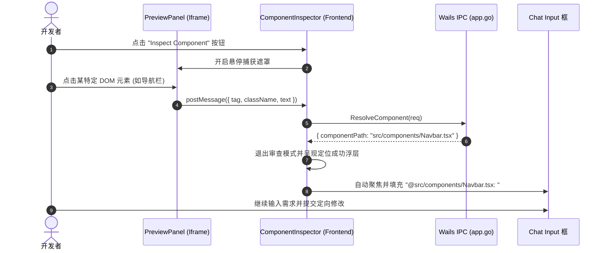
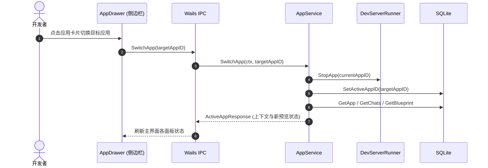

# 架构与系统设计说明书（Design）· Blot-UI v3

> 文件路径：`docs/spec/versions/v3/design.md`  
> 规范版本：v3 · 日期：2026-11-21  
> 状态：就绪（Ready for Review）  
> 选型基准：Wails v2 + React 19 + TypeScript + Go 1.26 + SQLite + Git CLI  
> 官方源码参考：[https://github.com/dyad-sh/dyad](https://github.com/dyad-sh/dyad)

---

## 1. 架构演进全景

Blot-UI v3 在原有架构基础上，引入多应用抽屉管理、可视化组件审查器与工程归档导出模块：

```mermaid
graph TD
    subgraph Frontend [React 19 + TypeScript 前端架构]
        AppUI[App.tsx 主工作区]
        AppDrawer[AppDrawer.tsx 侧边栏多应用抽屉]
        InspectorUI[ComponentInspector.tsx 预览审查模式]
        ExportModal[ExportModal.tsx 工程导出面板]
        ChatArea[ChatStream.tsx 提示词与定向组件前缀]
        PreviewArea[PreviewPanel.tsx 实时 Iframe 容器]
    end

    subgraph WailsBridge [Wails IPC 桥接层 app.go]
        AppMethods[SwitchApp / DeleteApp / ListApps]
        InspectorMethods[ResolveComponent]
        ExportMethods[ExportAppZip / OpenInFileManager]
        EventBus[runtime.EventsEmit / EventsOn]
    end

    subgraph BackendCore [Go 后端核心微服务]
        AppService[internal/app / AppService]
        InspectorService[internal/inspector / InspectorService]
        ExportService[internal/export / ExportService]
        AgentService[internal/agent / ChatService]
        RunnerService[internal/app/runner / DevServerSupervisor]
        Storage[internal/db / SQLite (apps, settings, chats, versions)]
    end

    AppUI --> AppDrawer
    AppUI --> ExportModal
    AppUI --> ChatArea
    AppUI --> PreviewArea
    PreviewArea --> InspectorUI

    AppDrawer --> AppMethods
    InspectorUI --> InspectorMethods
    InspectorUI -. 自动注入前缀 .-> ChatArea
    ExportModal --> ExportMethods

    AppMethods --> AppService
    InspectorMethods --> InspectorService
    ExportMethods --> ExportService

    AppService --> Storage
    AppService --> RunnerService
    InspectorService --> AppService
    ExportService --> Storage
```

---

## 2. 核心数据流设计

### 2.1 预览区组件定位与定向 Prompt 交互流



### 2.2 多应用无缝切换流



---

## 3. 项目结构演进

```
BuildUI/
├── app.go                          # Wails 统一 RPC 导出门面 (新增 SwitchApp, ExportAppZip 等)
├── internal/
│   ├── app/                        # 应用服务与脚手架管理
│   │   ├── app_service.go          # 扩展 SwitchApp, DeleteApp, ActiveApp 状态
│   │   └── runner/                 # 开发服务器管理
│   ├── export/                     # [新增] 工程导出与原生文件管理器调度
│   │   ├── exporter.go             # 目录递归打包与忽略规则 (.git, node_modules)
│   │   └── reveal.go               # 跨平台资源管理器唤起 (Windows/macOS/Linux)
│   ├── inspector/                  # [新增] 组件审查与源码文件路径映射器
│   │   └── resolver.go             # DOM 元素与工程源码路径逆向解析
│   ├── agent/                      # 提示词组装与会话
│   ├── blueprint/                  # 蓝图门禁
│   ├── db/                         # SQLite 数据层 (支持 cascade 删除与 active_id)
│   ├── llm/                        # 大模型流式 Provider
│   └── version/                    # Git 时光机与 Diff
└── frontend/
    └── src/
        ├── App.tsx                 # 主工作区与全局抽屉状态
        └── components/
            ├── AppDrawer.tsx       # [新增] 侧边栏多应用管理面板
            ├── ComponentInspector.tsx # [新增] 审查模式浮层与高亮
            ├── ExportModal.tsx     # [新增] 工程打包导出与打开目录模态框
            ├── SettingsModal.tsx   # 设置中心
            ├── VersionTimelineModal.tsx # 时光机
            └── PreviewPanel.tsx    # 实时预览面板 (集成审查工具按钮)
```

---

## 4. 技术选型表

| 层次 | 模块 / 能力 | 选型方案 | 选型理由 |
| :--- | :--- | :--- | :--- |
| **后端** | 归档压缩 | Go 标准库 `archive/zip` + `io` | 零第三方依赖、高性能且内存占用可控，可灵活定制文件忽略规则 |
| **后端** | 资源管理器调用 | Go 标准库 `os/exec` | 精确区分 `windows`、`darwin`、`linux` 执行参数，无缝调起桌面原生文件系统 |
| **后端** | 数据库与外键 | `modernc.org/sqlite` | 纯 Go 编译，严谨支持 `PRAGMA foreign_keys = ON` 外键级联删除，无需 CGO |
| **前端** | 侧边栏抽屉与浮层 | Tailwind CSS + Lucide Icons + React 19 状态 | 轻量原生、无冗余庞大 UI 库负担，流畅过渡动画 |
| **前端** | 审查跨跨域通信 | HTML5 `Window.postMessage` API | 隔离 Iframe 与宿主沙箱安全边界，精确监听 DOM 选中事件 |

---

## 5. 测试工具选型

> 遵循 SDD 约束：本章节仅列出测试框架名称，覆盖率指标与测试策略见 `test_strategy.md`。

- **后端单元测试 / 集成测试**：Go 标准库 `testing`
- **前端单元测试 / 组件测试**：Vitest + React Testing Library + JSDOM
- **端到端测试与视觉回归**：Playwright MCP / Playwright CLI（Google Chrome）

---

## 6. 安全性说明

1. **路径遍历防御 (Zip Slip Prevention)**：
   - 在 `ExportAppZip` 递归读取与归档文件时，使用 `filepath.Rel` 与 `filepath.Clean` 严格断言所有文件均处于工作区根路径以内，严禁任何包含 `..` 的软链接或越权读取。
2. **命令注入防护 (Command Injection Defense)**：
   - 唤起系统资源管理器时，使用 `exec.Command(binary, args...)` 的参数数组形式，严禁直接拼接 shell 命令字符串，杜绝文件名特殊字符导致的命令注入漏洞。
3. **级联删除安全保护**：
   - 处于激活或正在运行开发服务器状态的应用被禁止执行删除；删除需在独立事务中完成，确保原子性。

---

## 7. 数据库与接口设计引用

- **数据库设计**：详见 [docs/spec/versions/v3/data.md](data.md)
- **接口契约设计**：详见 [docs/spec/versions/v3/api.md](api.md)
