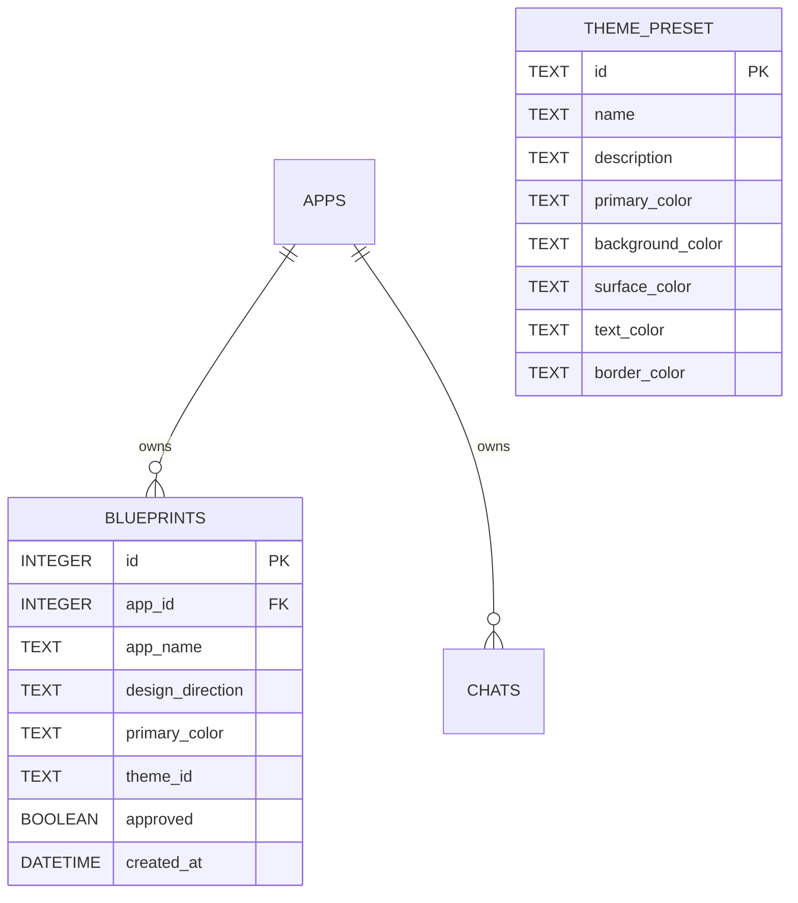

# 数据模型与存储契约（Data Contract）· Blot-UI v4

> 文件路径：`docs/spec/versions/v4/data.md`  
> 规范版本：v4 · 日期：2026-11-21  
> 状态：就绪（Ready for Review）  
> 选型基准：SQLite 3 (WAL 并发模式)  

---

## 1. 实体关系模型 (ERD)

---

## 2. 预设主题集定义 (Theme Presets Definition)

| Theme ID | 名称 | 主色 (Primary) | 背景色 (Background) | 表面卡片色 (Surface) | 文本主色 (Text) |
|:---|:---|:---|:---|:---|:---|
| `dark-slate` | Midnight Slate (默认暗黑) | `#3b82f6` (Blue) | `#020617` (Slate 950) | `#0f172a` (Slate 900) | `#f8fafc` |
| `cyberpunk-neon` | Cyberpunk Neon | `#00ffcc` (Neon Cyan) | `#0a0a12` (Deep Void) | `#16162a` (Neon Surface) | `#00ffcc` |
| `forest-emerald` | Forest Emerald | `#10b981` (Emerald) | `#051b14` (Deep Forest) | `#0c2e22` (Emerald Surface)| `#ecfdf5` |
| `sunset-glow` | Sunset Glow | `#f97316` (Orange) | `#1a0f0a` (Warm Night) | `#2b1810` (Warm Surface) | `#fff7ed` |
| `clean-light` | Minimalist Light | `#2563eb` (Royal Blue) | `#ffffff` (Pure White) | `#f8fafc` (Slate 50) | `#0f172a` |

---

## 3. SQLite DDL 迁移确认

`blueprints` 表在 v1 阶段初始创建时已包含 `theme_id TEXT` 字段。v4 阶段将该字段与上述 5 大官方主题预设深度联动，并在应用创建与切换时维持双向同步。
