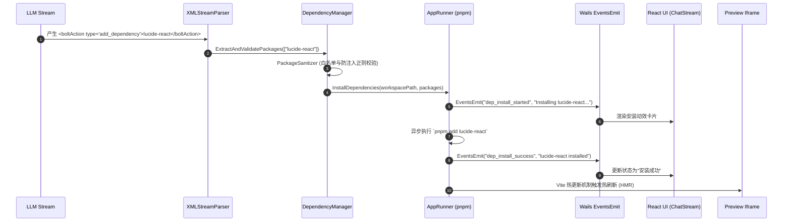
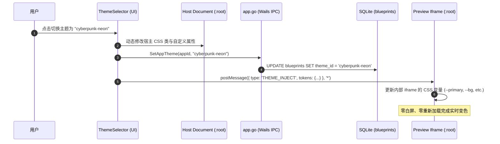

# 架构与系统设计说明书（Design）· Blot-UI v4

> 文件路径：`docs/spec/versions/v4/design.md`  
> 规范版本：v4 · 日期：2026-11-21  
> 状态：就绪（Ready for Review）  
> 选型基准：Wails v2 + React 19 + TypeScript + Go 1.26 + SQLite + Git CLI  
> 官方源码参考：[https://github.com/dyad-sh/dyad](https://github.com/dyad-sh/dyad)

---

## 1. 架构演进全景

Blot-UI v4 在现有微内核架构上扩展**动态依赖管理服务（DependencyManager）**与**双向 UI 主题预设引擎（ThemeEngine）**：

```mermaid
graph TD
    subgraph Frontend [React 19 + TypeScript 前端架构]
        AppUI[App.tsx 主工作区]
        ThemeSelector[ThemeSelector.tsx 顶部主题下拉切换]
        ChatArea[ChatStream.tsx 依赖安装进度指示]
        PreviewArea[PreviewPanel.tsx 实时 Iframe 容器]
        ThemeInjector[theme-injector.ts 跨沙箱 postMessage]
    end

    subgraph WailsBridge [Wails IPC 桥接层 app.go]
        ThemeMethods[GetThemePresets / SetAppTheme]
        DepMethods[InstallDependencies]
        EventBus[runtime.EventsEmit / EventsOn]
    end

    subgraph BackendCore [Go 后端核心微服务]
        DepService[internal/agent / DependencyManager & Sanitizer]
        RunnerService[internal/app/runner / DevServer & PackageInstaller]
        ThemeService[internal/theme / ThemeService]
        Storage[internal/db / SQLite (blueprints, apps)]
    end

    AppUI --> ThemeSelector
    AppUI --> ChatArea
    AppUI --> PreviewArea
    ThemeSelector --> ThemeInjector
    ThemeInjector -. postMessage: THEME_INJECT .-> PreviewArea
    ThemeSelector --> ThemeMethods

    ChatArea --> DepMethods
    DepMethods --> DepService
    DepService --> RunnerService
    RunnerService -. EventsEmit: dep_install_progress .-> EventBus
    EventBus -. 实时进度 .-> ChatArea

    ThemeMethods --> ThemeService
    ThemeService --> Storage
```

---

## 2. 核心执行时序图

### 2.1 智能第三方依赖提取与沙箱异步安装时序



---

### 2.2 UI 视觉主题预设与沙箱零刷新注入时序



---

## 3. 容错与防御策略

1. **依赖包名防命令注入（Sanitization Defense）**：
   - 包名必须符合严格白名单，拒绝任何包含 `&`, `|`, `;`, `$`, `` ` ``, `\`, `/../` 的非法字符；
   - 依赖安装使用 Go 原生 `exec.CommandContext` 传参，严禁字符串拼接传递给 shell。
2. **多线程并发安全与 Vite 冲突保护**：
   - 依赖安装执行期间加互斥锁，避免针对同一个应用同时触发多个并发 `pnpm add` 导致锁文件竞争；
   - 安装失败不污染当前工作区已正常运行的前端进程。
