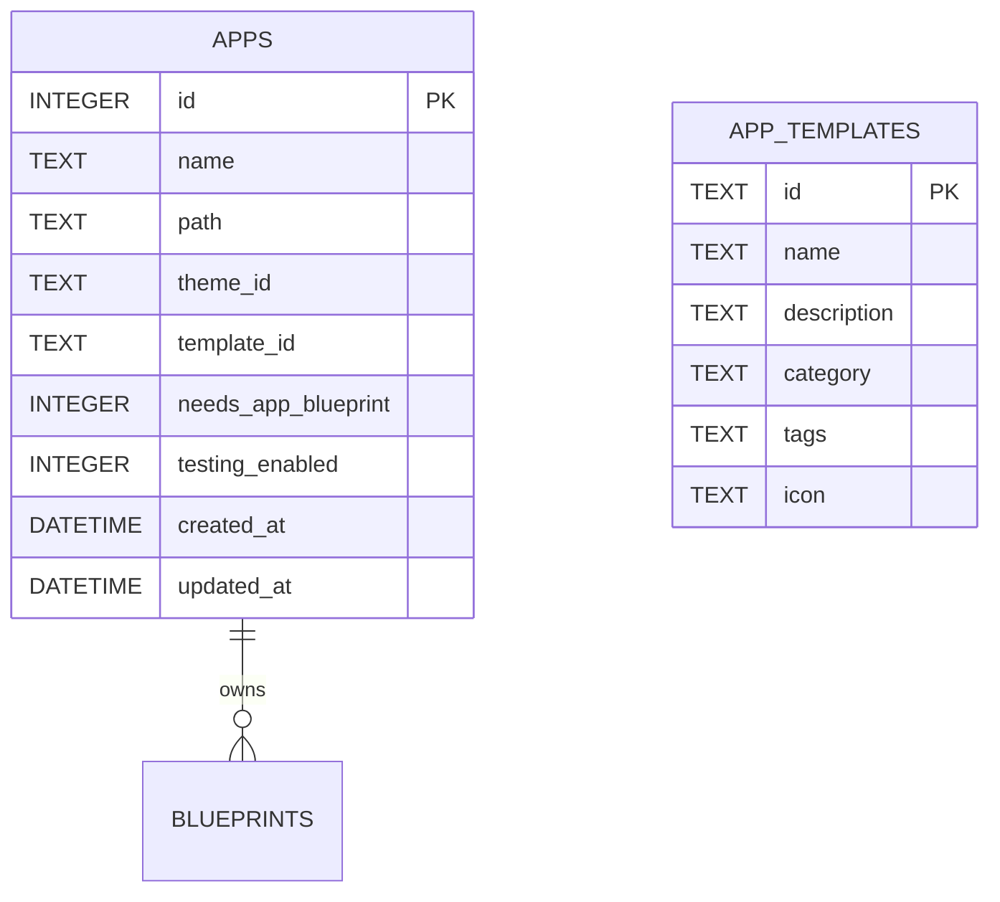

# 数据模型与存储契约（Data Contract）· Blot-UI v5

> 文件路径：`docs/spec/versions/v5/data.md`  
> 规范版本：v5 · 日期：2026-11-21  
> 状态：就绪（Ready for Review）  
> 选型基准：SQLite 3  

---

## 1. 实体关系模型 (ERD)

---

## 2. 内置官方模版清单 (Built-in App Templates)

| Template ID | 模版名称 | 分类 (Category) | 包含核心组件 | 默认主题 |
|:---|:---|:---|:---|:---|
| `saas-dashboard` | SaaS Analytics Dashboard | Analytics | 动态折线图表、关键 KPI 卡片、侧边导航、数据表格 | `dark-slate` |
| `portfolio` | Creative Developer Portfolio | Personal | 个人 Hero 头像展、技能标签墙、精选项目卡片、联络表单 | `cyberpunk-neon` |
| `landing-page` | Modern Product Landing Page | Marketing | 渐变大标题 Hero、特性卡片网格、定价阶梯表、FAQ 手风琴 | `clean-light` |
| `storefront` | E-Commerce Showcase | Commerce | 商品网格列表、购物车抽屉、筛选分类栏、结账徽章 | `sunset-glow` |
