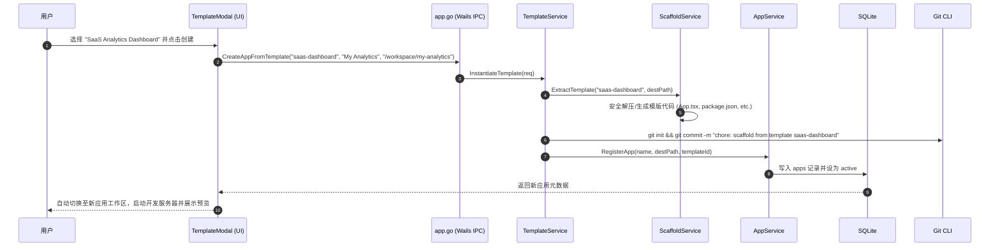
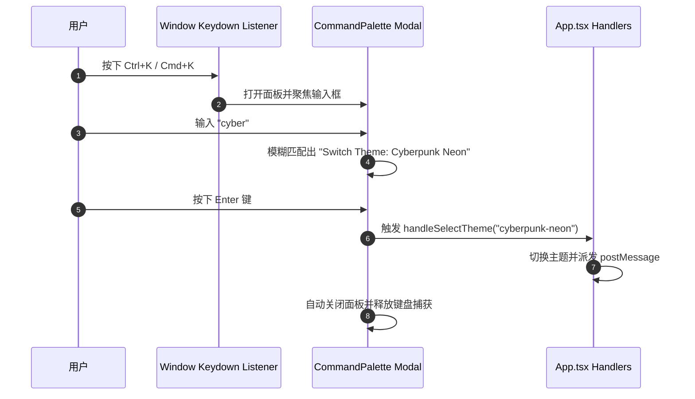

# 架构与系统设计说明书（Design）· Blot-UI v5

> 文件路径：`docs/spec/versions/v5/design.md`  
> 规范版本：v5 · 日期：2026-11-21  
> 状态：就绪（Ready for Review）  
> 选型基准：Wails v2 + React 19 + TypeScript + Go 1.26 + SQLite + Git CLI  
> 官方源码参考：[https://github.com/dyad-sh/dyad](https://github.com/dyad-sh/dyad)

---

## 1. 架构演进全景

Blot-UI v5 在原有微服务基础上，扩展**模版服务（TemplateService）**与前端**全局命令面板（CommandPalette）**：

```mermaid
graph TD
    subgraph Frontend [React 19 + TypeScript 前端架构]
        AppUI[App.tsx 主工作区]
        CommandPalette[CommandPalette.tsx 全局命令面板 Ctrl+K]
        TemplateModal[TemplateModal.tsx 模版选择与快速拉起]
        ThemeEngine[ThemeSelector.tsx 主题预设]
        AppDrawer[AppDrawer.tsx 侧边应用抽屉]
        PreviewArea[PreviewPanel.tsx 实时预览]
    end

    subgraph WailsBridge [Wails IPC 桥接层 app.go]
        TemplateMethods[GetAppTemplates / CreateAppFromTemplate]
        AppMethods[SwitchApp / DeleteApp / ListApps]
        ThemeMethods[GetThemePresets / SetAppTheme]
    end

    subgraph BackendCore [Go 后端核心微服务]
        TemplateService[internal/template / TemplateService]
        ScaffoldService[internal/scaffold / ScaffoldService]
        AppService[internal/app / AppService]
        Storage[internal/db / SQLite (apps, blueprints)]
    end

    AppUI -. Ctrl+K 快捷键 .-> CommandPalette
    CommandPalette -. 快捷触发 .-> ThemeEngine
    CommandPalette -. 快捷触发 .-> AppDrawer
    CommandPalette -. 快捷触发 .-> PreviewArea
    AppDrawer -. 新建项目 .-> TemplateModal

    TemplateModal --> TemplateMethods
    TemplateMethods --> TemplateService
    TemplateService --> ScaffoldService
    TemplateService --> AppService
    AppService --> Storage
```

---

## 2. 核心执行时序图

### 2.1 从模版一键初始化工程时序



---

### 2.2 全局命令面板模糊匹配与键盘执行时序


