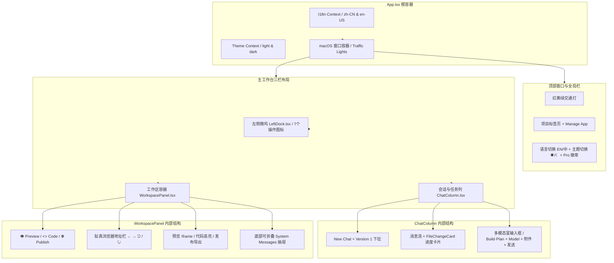
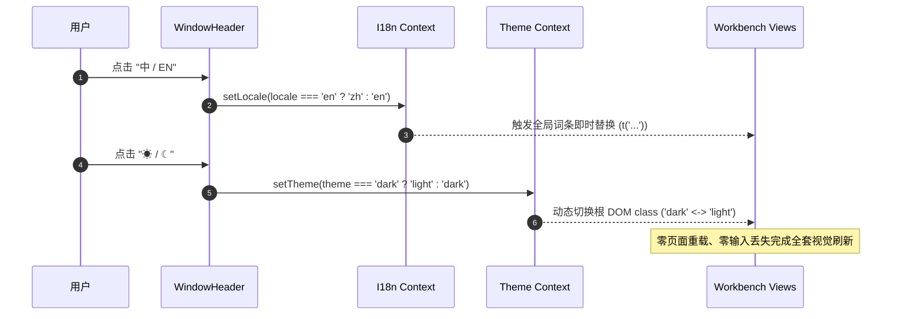

# 架构与系统设计说明书（Design）· Blot-UI v6

> 文件路径：`docs/spec/versions/v6/design.md`  
> 规范版本：v6 · 日期：2026-11-21  
> 状态：就绪（Ready for Review）  
> 选型基准：Wails v2 + React 19 + TypeScript + Tailwind CSS  
> 官方源码参考：[https://github.com/dyad-sh/dyad](https://github.com/dyad-sh/dyad)

---

## 1. 架构演进全景

Blot-UI v6 重构前端视图层为 macOS 工业级三栏式容器架构，并引入双模主题引擎与双语 i18n 响应式上下文：

---

## 2. 配色系统与 macOS 设计规范 (Design Tokens)

### 2.1 浅色模式 (macOS Light Mode)
- **Window Surface**: `#ffffff` / `bg-white`
- **Window Chrome / Titlebar**: `#f5f5f7` (macOS 系统浅灰)
- **Border / Dividers**: `#e5e5ea` / `border-slate-200`
- **Left Dock Background**: `#f8f9fa`
- **User Message Bubble**: `#e8e5ff` (淡紫色优雅气泡), 文本 `#2c246b`
- **Assistant Message Card**: `#ffffff` 纯白卡片，带 `#e2e8f0` 细微边框与 `shadow-sm`
- **File Card Hover**: `hover:border-blue-400 hover:shadow-md`
- **Accent Purple Active**: `#7c3aed` / `bg-purple-600/10 text-purple-600`

### 2.2 深色模式 (macOS Dark Mode)
- **Window Surface**: `#18181b` (Zinc 900)
- **Window Chrome / Titlebar**: `#121215` (Zinc 950 极深灰)
- **Border / Dividers**: `#27272a` / `border-zinc-800`
- **Left Dock Background**: `#111114`
- **User Message Bubble**: `#312e81/70` (深紫外光感气泡), 文本 `#e0e7ff`
- **Assistant Message Card**: `#1e1e24` 磨砂暗色，带 `#3f3f46/40` 微描边
- **File Card Hover**: `hover:border-purple-500/50 hover:bg-zinc-900`
- **Accent Purple Active**: `#a78bfa` / `bg-purple-500/20 text-purple-300`

---

## 3. 核心时序图：多语言与主题联动

