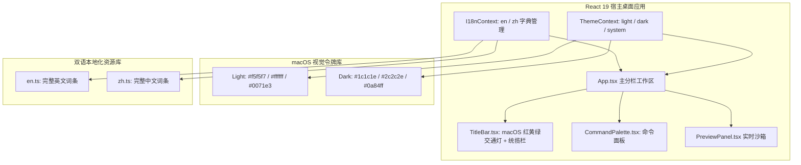
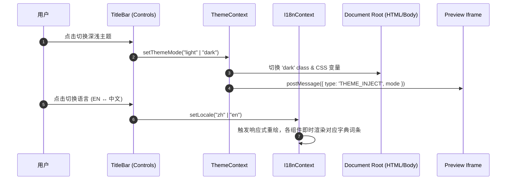

# 架构与系统设计说明书（Design）· Blot-UI v6

> 文件路径：`docs/spec/versions/v6/design.md`  
> 规范版本：v6 · 日期：2026-11-21  
> 状态：就绪（Ready for Review）  
> 选型基准：Wails v2 + React 19 + TypeScript + Tailwind CSS  
> 官方源码参考：[https://github.com/dyad-sh/dyad](https://github.com/dyad-sh/dyad)

---

## 1. 架构演进全景

Blot-UI v6 在前端工程中引入 **macOS 主题引擎（ThemeContext）** 与 **轻量国际化体系（I18nContext）**：

---

## 2. macOS 视觉规范与 Token 映射

| 语义分类 | macOS 浅色 (Light Mode) | macOS 深色 (Dark Mode) | 说明 |
|:---|:---|:---|:---|
| **Window Background** | `#f5f5f7` (macOS 系统浅灰) | `#1c1c1e` (macOS Space Gray) | 窗口最底层背景 |
| **Surface / Card** | `rgba(255, 255, 255, 0.85)` | `rgba(44, 44, 46, 0.8)` | 半透明卡片表面 |
| **Header Toolbar** | `rgba(255, 255, 255, 0.7)` | `rgba(28, 28, 30, 0.75)` | 磨砂毛玻璃高斯模糊 (`backdrop-blur-xl`) |
| **Border / Divider** | `rgba(0, 0, 0, 0.08)` | `rgba(255, 255, 255, 0.12)` | 超细柔和微边框 |
| **Text Primary** | `#1d1d1f` (SF Pro Black) | `#f5f5f7` (SF Pro White) | 主标题与核心内容 |
| **Text Muted** | `#86868b` (SF Pro Gray) | `#98989d` (SF Pro Dark Gray) | 辅助描述与标签 |
| **System Accent** | `#0071e3` (Apple Royal Blue) | `#0a84ff` (Apple Neon Blue) | 重点按键与活跃高亮 |
| **Traffic Lights** | Close `#ff5f56`, Min `#ffbd2e`, Max `#27c93f` | Close `#ff5f56`, Min `#ffbd2e`, Max `#27c93f` | 经典三色交通灯点 |

---

## 3. 国际化与双模切换执行时序

