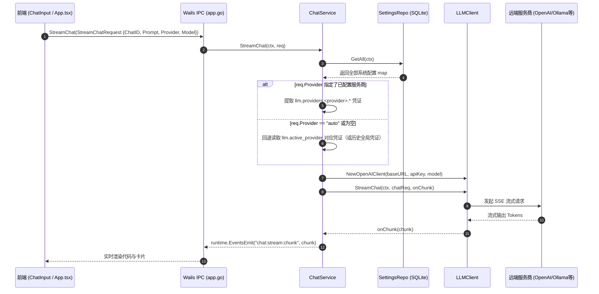

# 架构与技术方案设计（Design）· Blot-UI v7

> 文件路径：`docs/spec/versions/v7/design.md`  
> 规范版本：v7 · 日期：2026-11-21  
> 状态：已定稿（finalized）  
> 关联版本索引：[docs/spec/README.md](file:///Volumes/data/Nextcloud/coding/desktop/BuildUI/docs/spec/README.md)  
> 核心宪法继承：[docs/spec/versions/v1-finished/constitution.md](file:///Volumes/data/Nextcloud/coding/desktop/BuildUI/docs/spec/versions/v1-finished/constitution.md)

---

## 1. 项目结构

本次迭代涉及的核心模块路径分布如下：

```
BuildUI/
├── frontend/
│   └── src/
│       ├── components/
│       │   ├── ModelSelector.tsx         # 模型选择下拉浮层组件
│       │   ├── ModelSelector.test.tsx    # 组件单元交互测试
│       │   ├── SettingsModal.tsx         # 偏好设置多 Provider 标签页与表单
│       │   └── SettingsModal.test.tsx    # 偏好设置交互测试
│       ├── types/
│       │   └── provider.ts               # Provider 配置与模型类型定义
│       └── i18n/
│           └── locales/{en,zh}.ts        # 多服务商相关中英文案
├── internal/
│   ├── settings/
│   │   ├── service.go                    # 配置隔离读写与模型列表拉取服务
│   │   └── service_test.go               # 服务单元测试
│   ├── agent/
│   │   ├── service.go                    # StreamChatRequest 请求体扩展
│   │   ├── model_chat.go                 # 动态 Provider/Model 定向流式调度
│   │   └── service_test.go               # 定向分发与回退测试
│   └── llm/
│       ├── client.go                     # 模型端点调用与连通性
│       └── types.go                      # LLM 通用结构定义
├── app.go                                # Wails IPC 绑定层（ListProviderModels 等）
└── docs/spec/versions/v7/                # v7 规格说明与任务包
```

---

## 2. 架构概览与系统组件关系

Blot-UI v7 在维持原有单体桌面应用与 SQLite 存储架构的基础上，升级了大模型服务调度中枢（Multi-Provider LLM Suite）：

```mermaid
graph TD
    subgraph Frontend [前端视图层 (React 19)]
        InputToolbar[ChatToolbar 输入工具栏]
        ModelSelector[ModelSelector 模型下拉]
        SettingsModal[SettingsModal 偏好设置]
    end

    subgraph IPC [Wails IPC 桥接层]
        AppBindings[app.go 暴露接口]
    end

    subgraph Backend [Go 后端业务层]
        SettingsService[SettingsService 配置服务]
        ChatService[ChatService 调度引擎]
        LLMClient[LLM Provider 客户端]
    end

    subgraph Storage [持久化与外部服务]
        SQLite[(SQLite settings 表)]
        RemoteLLM[外部 LLM 端点 (OpenAI / DeepSeek / Ollama / Custom)]
    end

    InputToolbar --> ModelSelector
    ModelSelector -- "快捷进入" --> SettingsModal
    ModelSelector -- "选择 Provider / Model" --> InputToolbar
    SettingsModal -- "SaveSettings / TestConnection" --> AppBindings

    AppBindings --> SettingsService
    AppBindings --> ChatService
    SettingsService --> SQLite
    SettingsService --> LLMClient
    ChatService --> SQLite
    ChatService --> LLMClient
    LLMClient --> RemoteLLM
```

---

## 3. 核心数据流时序图

### 3.1 会话定向流式分发与回退流程



---

## 4. 技术选型

| 维度 | 选型 | 理由 |
|------|------|------|
| **存储方案** | 原生 SQLite `settings` 表 | 现成轻量键值存储，采用 `llm.providers.<provider>.*` 前缀完全满足多服务商凭证隔离，无需破坏既有数据库 Schema。 |
| **通信协议** | Wails IPC (Go / TypeScript) | 强类型无缝双向通信，安全调用本地系统与网络库。 |
| **前端状态管理** | React Hooks + State Lifting | 局部状态内聚于组件，全局活跃 Provider 与已配列表由应用顶层单向流动分发。 |
| **下拉选择交互** | Tailwind CSS + Lucide Icons + Native DOM Listeners | 零重量级额外依赖，保持 macOS 原生简约毛玻璃美学与极速启动。 |

---

## 5. 测试工具选型

> ⚠️ 注意：根据 SDD 规约，此处仅列出框架名称，覆盖率指标与执行矩阵见 `test_strategy.md`。

| 场景 | 工具 |
|------|------|
| Go 单元测试 / 服务测试 | `go test` |
| React 组件与 Hook 测试 | Vitest + React Testing Library |
| 端到端交互与视觉验证 | Playwright MCP |

---

## 6. 安全性与凭证管理

1. **密钥本地隔离**：所有 API Key 均持久化于本机用户目录下的 SQLite 数据库（`appDataDir/buildui.db`），禁止通过任何日志、前端错误气泡输出明文密钥。
2. **凭据掩码保护**：在前端设置界面中，API Key 默认展示为密码输入框（`type="password"`），避免屏幕共享或录屏泄漏。
3. **输入校验与超时防护**：后端发起的 `TestConnection` 与 `ListProviderModels` 均施加严格的上下文超时限制（10 秒），防止悬挂请求耗尽系统资源。

---

## 7. 契约引用

- **数据库与数据结构契约**：详见 [docs/spec/versions/v7/data.md](file:///Volumes/data/Nextcloud/coding/desktop/BuildUI/docs/spec/versions/v7/data.md)
- **接口与通信契约**：详见 [docs/spec/versions/v7/api.md](file:///Volumes/data/Nextcloud/coding/desktop/BuildUI/docs/spec/versions/v7/api.md)
